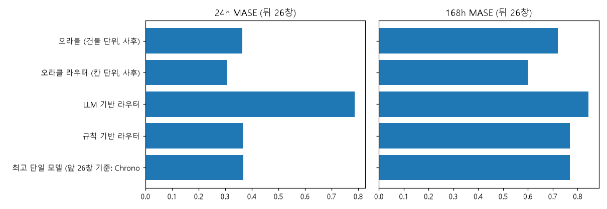

# 주간 보고서 — 10주차

## 1. 기본 정보
- 주차 / 기간: 10주차, 2026-11-07 ~ 2026-11-08
- 작성자: 김동호
- 실습시간: 계획 8h / 실제 10h

## 2. 이번 주 목표
1. 지금까지의 예측기(Seasonal Naive, LightGBM, Chronos-2, TTM, 딥러닝 4종)를 같은 호출 형식(`학습 데이터, horizon → 예측`)으로 감싸 2주차 하네스에서 모두 호출되는지 확인한다.
2. 건물별 라우팅 신호(이력 길이, 결측률, 공변량 유무, 주기성 강도, 최근 잔차 수준)를 계산하는 상태 수집 노드를 만들어 17개 건물 표로 저장한다.
3. 1~9주차 결과를 근거로 규칙 기반 라우터를 만들고, 최고 단일 모델(Chronos-2 + 공변량: 24h 0.3545 / 168h 0.6969)과 MASE를 같은 52창에서 비교한다.

> **변경·추가**
> - **모델 풀에서 딥러닝 4종 제외**: 6종(Seasonal Naive, LightGBM local·global, Chronos-2, Chronos-2 + 공변량, TTM 512). 8주차 딥러닝은 성능이 낮고 체크포인트를 저장하지 않아 실제 호출이 어렵다.
> - **"같은 52창에서 비교" → "앞 26창으로 규칙을 정하고 뒤 26창에서만 비교"로 변경**: 52창으로 규칙을 정하고 같은 52창에서 평가하면 2주차에 배운 누수와 같은 문제 발생.
> - **LLM 라우터**: gpt-4o-mini, temperature 0, 구조화 출력. 호출은 (윈도우 × horizon)당 1회로 건물 17개를 한 번에 결정 → 평가 52회(+개발 점검 호출). 비용은 토큰 수에 `.env` 단가(입력 $0.15 / 출력 $0.60, 100만 토큰당)를 곱해 계산 (API 재호출 없이 `llm_cost.csv` 갱신).
> - 교재 10-6(실패 분석)과 오라클 격차 진단, 콜드스타트 보조 비교를 추가로 수행.

## 3. 수행 내역

|   | 과제 | 산출물 |
|---|---|---|
| 1 | 10-1. 통일 인터페이스 + 풀 준비 | `src/routing.py` (`Forecaster`, `Pool`), `results/wk10/preds/*.csv`(LightGBM local·TTM 윈도우별 예측 재생성) |
| 2 | 10-2. 상태 수집 노드 | `results/wk10/state_signals.csv` (884행 = 52창 × 17건물), `signal_vs_gain.csv` |
| 3 | 10-3. 규칙 기반 라우터 | `fit_window_evidence.csv`, `textbook_rules_check.csv`, `learned_rules.csv`, `routing_log_rule_{24,168}h.csv` |
| 4 | 10-4. LLM 라우터 | `src/routing.py` (`llm_route_window`, 구조화 출력), `routing_log_llm_{24,168}h.csv`, `llm_cost.csv` |
| 5 | 10-5. 정직한 비교 | `router_comparison.csv`, `router_comparison.png`, `rule_vs_single_paired.csv`, `oracle_gap.csv` |
| 6 | 10-6. 실패 분석 | `failure_regret.csv`, `failure_missed.csv` |
| 7 | (추가) 오라클 이득 진단 · 콜드스타트 | `oracle_gain_concentration.csv`, `posthoc_surge_rule.csv`, `coldstart_oracle_gap.csv` |
| - | 노트북 (CPU) | `notebooks/wk10_routing.ipynb` |

**공통 조건**
- 평가: 2주차 하네스 그대로 (2017년 52창, step 168h, expanding, MASE 분모 = 첫 평가 시점 이전 계절 naive 168h). **라우터 비교는 뒤 26창(윈도우 26~51)만**
- 라우터가 (윈도우, 건물)마다 풀에서 모델 하나를 고르고, 후보의 윈도우별 예측은 1~8주차에 저장된 것을 **조회**해 `score_backtest`로 채점. 모델을 다시 학습·추론하지 않음 (LightGBM local·TTM만 재생성)
- 누수 방지: 상태 신호는 origin 이전 데이터로만 계산. 규칙·기본값(최고 단일 모델)은 앞 26창으로만 결정
- 장비: 노트북 CPU. GPU 불필요
- 베이스라인: 뒤 26창의 Seasonal Naive = 24h **1.0969** / 168h **1.0319** (52창 전체 0.9673 / 0.9767과 다름 — 뒤 26창이 더 어려운 구간)

## 4. 정량 결과

### 4-1. 풀 점검 (과제 10-1)

| 점검 | 결과 |
|---|---|
| 풀 6종의 52창 MASE가 6주차 표와 같은가 | **전부 일치** (소수 넷째 자리, 최대 차이 0.0) |
| 통일 인터페이스: live 호출과 저장 예측이 같은가 (24h, 윈도우 30) | Seasonal Naive 0 / LightGBM local·global 2e-13 / TTM 5e-5. Chronos-2 두 종은 다운로드가 커서 live 점검 제외 |
| 재생성한 예측 | LightGBM local · TTM(512) × 24h·168h, 총 412초 |

### 4-2. 상태 신호 (과제 10-2)

| 신호 | 범위 | 비고 |
|---|---|---|
| 이력 길이 (h) | 8,843 ~ 17,520 | **전 칸이 1년 이상 → 교재의 "이력 < 3개월" 규칙은 발동 불가** |
| 결측률 (28일) | 0 ~ 0.107 | 평균 0.001 |
| 공변량 유무 (외기온 가용률) | 0.967 ~ 1.0 | 사실상 상수 |
| 주기성 acf168 / acf24 | −0.245 ~ 0.973 / −0.030 ~ 0.966 | |
| 최근 잔차 수준 (직전 1주 Naive MASE) | 0.033 ~ 10.03 | 중앙값 0.715, 75% 1.197 |

**신호와 "최고 단일 모델을 다른 모델이 이기는 정도"의 상관 (앞 26창, Spearman)**

| 신호 | 24h | 168h |
|---|---|---|
| acf168 | −0.008 | −0.083 |
| acf24 | −0.037 | −0.053 |
| 이력 길이 | −0.053 | −0.022 |
| 결측률 | −0.006 | 0.042 |
| 공변량 가용률 | 0.010 | −0.021 |
| 최근 잔차 수준 | −0.089 | **−0.172** |

모든 신호의 상관이 |0.17| 이하.

### 4-3. 규칙 근거 (과제 10-3, 앞 26창)

**모델별 평균 MASE (앞 26창)** — 최고 단일 모델 = **Chronos-2 + 공변량** (24h·168h 모두)

| 모델 | 24h | 168h | 지연 (ms/계열) |
|---|---|---|---|
| Seasonal Naive | 0.8371 | 0.9221 | 0.07 |
| LightGBM (local) | 0.5260 | 0.9171 | 17.8 |
| LightGBM (global) | 0.6228 | 0.9557 | 25.3 |
| Chronos-2 | 0.3721 | 0.7442 | 154.7 |
| **Chronos-2 + 공변량** | **0.3404** | **0.6251** | 294.1 |
| TTM (ctx=512) | 0.7165 | 1.0309 | 4.4 |

**교재 규칙 5가지를 앞 26창에서 실측 (기본값 대비 대상 모델의 MASE 변화, 마이너스 = 나빠짐)**

| 교재 규칙 | 발동 칸 | 24h | 168h |
|---|---|---|---|
| R1 이력 < 3개월 → TSFM | 0 | — | — |
| R2 이력 > 1년 + 공변량 → LightGBM (local) | 442 (전부) | −54.5% | −46.7% |
| R2′ 같은 조건 → LightGBM (global) | 442 | −82.9% | −52.9% |
| R3 acf168 > 0.8 + 안정 → Seasonal Naive | 98 | −81.1% | −31.7% |
| R4 계열 많음 + 지연 엄격 → TTM | 0 | — | — |
| R5 최근 잔차 3배 급증 → Naive (이상 분기 대체 평가) | 31 | −278.9% | −74.1% |

**데이터에서 탐색한 규칙** (조건: 지원 칸 ≥ 60, 개선율 ≥ 3%, 앞·뒤 절반 모두 ≥ 1%)

| horizon | 규칙 | 지원 칸 | 앞 26창 개선율 | 앞 절반 / 뒤 절반 |
|---|---|---|---|---|
| 24h | `recent_naive_mase ≤ 0.329` → Chronos-2 (zero-shot) | 89 | 5.0% | 7.9% / 1.2% |
| 168h | 조건을 통과한 규칙 **없음** | — | — | — |

### 4-4. 과제 10-5 — 정직한 비교 (뒤 26창)

| 방식 | MASE 24h | Naive 대비 | MASE 168h | Naive 대비 | 평균 지연 24h / 168h (ms/계열) | LLM 비용 |
|---|---|---|---|---|---|---|
| 최고 단일 모델 (Chronos-2 + 공변량, 앞 26창으로 선택) | 0.3686 | −66.4% | 0.7689 | −25.5% | 294.1 / 294.1 | — |
| 규칙 기반 라우터 | 0.3669 | −66.6% | 0.7689 | −25.5% | 263.5 / 294.1 | — |
| LLM 기반 라우터 (gpt-4o-mini) | **0.7875** | −28.2% | **0.8427** | −18.3% | 606.4 / 678.3 | **$0.0213 / $0.0201** (합계 $0.0414) |
| 오라클 (칸 단위, 사후) | 0.3065 | −72.1% | 0.5998 | −41.9% | 169.2 / 197.7 | — |
| (참고) 오라클 (건물 단위, 사후) | 0.3650 | −66.7% | 0.7206 | −30.2% | 244.9 / 235.9 | — |

- **LLM 라우터 vs 최고 단일 모델: 24h +113.6% 나쁨(0.7875 vs 0.3686), 168h +9.6% 나쁨(0.8427 vs 0.7689). 17개 건물 전부에서 단일 모델보다 나쁘고(Wilcoxon p < 0.0001)**, 규칙 라우터보다도 나쁨. Seasonal Naive 대비로는 −28.2% / −18.3%로 Naive보다는 낫지만 단일 모델에는 크게 못 미침
- LLM 호출: (윈도우 × horizon) 26회씩, **응답 파싱 실패 0 · 건물 누락 0**. 토큰 24h 입력 43,914 / 출력 24,468, 168h 입력 43,914 / 출력 22,570. 평균 호출 지연 7.99s / 7.51s (건물 17개 1회) → 건물당 약 0.47 s
- 규칙 라우터 vs 단일 모델 (건물별 쌍 비교 17쌍): **24h 개선율 0.48%**, 라우터가 나은 건물 5 / 같은 건물 6 / 나쁜 건물 6, **Wilcoxon p = 0.48**. **168h는 규칙이 없어 17개 건물 전부 단일 모델과 동일**
- 오라클과의 격차 (단일 대비): 건물 단위 **1.0% (24h) / 6.3% (168h)**, 칸 단위 **16.8% / 22.0%**
- 규칙 라우터가 고른 모델: 24h 기본값 345칸 + Chronos-2 97칸 / 168h 전부 기본값 442칸. 결정 로그는 `routing_log_rule_*.csv`(전체 건물·윈도우, 선택 근거 열 포함)
- 규칙 결정 지연(상태 신호 이후)은 건물당 0.01 ms 미만이라 평균 지연 차이는 고른 모델의 추론 지연에서 나옴 (24h: Chronos-2가 공변량 모델보다 가벼워 −10%)

### 4-4b. LLM 라우터가 무엇을 골랐나 (뒤 26창, 칸 442개)

| horizon | 선택 모델 | 비중 | 선택 칸 평균 MASE | 같은 칸 기본값 MASE | 기본값 대비 손해 합 (regret) |
|---|---|---|---|---|---|
| 24h | Chronos-2 + 공변량 | 33.0% | 0.337 | 0.337 | 0 |
| 24h | Chronos-2 | 23.1% | 0.283 | 0.276 | 0.7 |
| 24h | **Seasonal Naive** | **22.4%** | **2.213** | 0.544 | **165.2 (전체의 89%)** |
| 24h | LightGBM (local) | 20.6% | 0.541 | 0.335 | 18.7 |
| 168h | Chronos-2 + 공변량 | 76.9% | 0.758 | 0.758 | 0 |
| 168h | Seasonal Naive | 14.5% | 1.142 | 0.751 | 25.0 (전체의 77%) |
| 168h | TTM (ctx=512) | 1.6% | 2.997 | 2.285 | 5.0 |

- 같은 건물에서도 창마다 선택이 바뀜: 건물당 서로 다른 모델 수 평균 4.1개(24h) / 3.0개(168h)
- **같은 입력을 다시 불렀을 때 결정 일치율** (개발 점검, 윈도우 3개 × 2회): 1차 실행 24h 0.647 / 168h 1.000, 2차 실행 24h 0.725 / 168h 0.725. **temperature 0인데도 결정이 흔들림** — 기록해 둘 사실
- (사후 참고, 평가창 기반이라 반영 안 함) Seasonal Naive 선택을 기본값으로 바꾸면 24h 0.4134 / 168h 0.7861 — 이 오류를 고쳐도 단일 모델(0.3686 / 0.7689)을 넘지 못함

### 4-5. 오라클 이득은 어디서 나오나 (사후 진단, 규칙 설계에는 미사용)

| horizon | 오라클(칸) 이득 중 상위 10칸 비중 | 가장 큰 달 | 상위 2개 건물 |
|---|---|---|---|
| 24h | 39.7% | 12월 (19.5%) | Rat_office_Lora, Fox_office_Vicki (29.6%) |
| 168h | **68.8%** | **11월 (59.2%)** | **Bull_office_Ella, Bull_office_Sally (52.5%)** |

**"최근 잔차 급증 → LightGBM (local)" 규칙을 앞·뒤 창에서 각각 평가 (개선율, 기본값 대비)**

| 조건 (168h) | 앞 26창 (발동 칸) | 뒤 26창 (발동 칸) |
|---|---|---|
| `recent_naive_mase > 3` | **−37.4%** (14) | **+30.0%** (21) |
| `recent_naive_mase > 5` | −15.6% (3) | +68.0% (6) |

24h에서는 같은 규칙이 앞 −102.3% / 뒤 −207.2%로 양쪽 다 나쁨.

### 4-6. 보조 — 콜드스타트(이력 2주)와 오라클 격차 (건물 단위 MASE)

| horizon | 조건 | 최고 단일 | 단일 MASE | 오라클(건물) | 격차 | 건물별 승자 |
|---|---|---|---|---|---|---|
| 24h | 이력 1년 이상 | Chronos-2 + 공변량 | 0.3545 | 0.3517 | 0.8% | 공변량 13, Chronos-2 4 |
| 24h | 콜드스타트 | Chronos-2 + 공변량 | 0.3917 | 0.3843 | 1.9% | 공변량 11, Chronos-2 6 |
| 168h | 이력 1년 이상 | Chronos-2 + 공변량 | 0.6969 | 0.6860 | 1.6% | 공변량 12, Chronos-2 4, Naive 1 |
| 168h | 콜드스타트 | Chronos-2 + 공변량 | 0.7760 | 0.7504 | 3.3% | 공변량 13, Chronos-2 2, Naive 1, LightGBM(global) 1 |

## 5. 해석

**10-1.**
- 풀 6종의 52창 점수가 6주차 표와 소수 넷째 자리까지 일치하고, 통일 인터페이스의 live 호출과 저장 예측이 수치 오차 수준(최대 5e-5)으로 같음. 따라서 라우터 평가가 "저장된 예측을 조회하는" 방식이어도 하네스 점수가 바뀌지 않음

결과: 어떤 예측기든 같은 방식으로 호출할 수 있고, 라우터 평가를 재학습 없이 할 수 있음

**10-2.**
- 이력 길이는 모든 칸이 8,843h 이상이고 공변량은 전 건물에 있어(가용률 ≥ 0.967), **5개 신호 중 2개는 구분력이 없음**. 이 데이터는 "신규 건물"을 포함하지 않아 이력 기반 규칙이 발동할 수 없음
- 남은 신호(주기성·최근 잔차)도 "다른 모델이 최고 단일 모델을 이기는 정도"와의 상관이 |0.17| 이하 (4-2 표). 판정 기준 ①(라우팅 신호가 실제 승패와 상관이 낮다)에 해당

**10-3.**
- 교재 규칙 중 **R1·R4는 발동 칸이 0**. **R2·R2′·R3·R5는 발동하면 오히려 −32% ~ −279%로 나빠짐**: 기본값(Chronos-2 + 공변량)이 24h 0.340으로 LightGBM local 0.526, Naive 0.837보다 압도적이라, 교재가 가정한 "이력이 길면 LightGBM" 같은 상황이 이 데이터에는 없음 (1~9주차 결과가 교재 규칙을 반증)
- 데이터로 찾은 규칙은 24h 하나: `직전 1주 Naive 오차가 낮으면(≤ 0.329) Chronos-2 zero-shot`. 앞 26창에서 5.0% 개선이지만 앞 절반 7.9% → 뒤 절반 1.2%로 **빠르게 약해짐**. 168h는 통과한 규칙이 없어 규칙 라우터가 단일 모델과 같음

결과: 규칙 라우터 = 사실상 기본값 모델 (24h는 97칸만 다름)

**10-5.**
- **라우터는 최고 단일 모델을 이기지 못함**: 24h MASE 0.3669 vs 0.3686 (−0.5%, p = 0.48), 168h 동일. 라우터가 나은 건물 5 / 나쁜 건물 6으로 방향도 갈림 → 차이가 노이즈 범위
- **건물 단위 오라클조차 단일 대비 1.0% (24h) / 6.3% (168h)** 만 앞섬 → 건물 하나를 고정 모델로 고르는 수준에서는 고를 여지가 작음. 칸 단위 오라클(16.8% / 22.0%)은 (윈도우, 건물)마다 사후에 정답을 알아야 하는 상한이라 도달 불가
- "이 데이터에 라우팅은 불필요"가 **뒤 26창 기준 24h에서는 정당한 결론**
- 168h는 사정이 다름: 오라클 이득이 **상위 10칸에 69%, 11월에 59%, Bull_office_Ella·Sally 두 건물에 52%** 몰려 있음. 이 두 건물은 2017년 11월 급증이 있는 건물로, 그때 LightGBM local이 기본값보다 훨씬 나았음 (칸 MASE 20.2 → 0.56, 21.1 → 2.67)
- 그 구간에는 "최근 잔차 급증" 신호가 높은데(7.9, 10.0), 앞 26창(1~6월)에는 급증이 거의 없고 있어도 방향이 반대(−37%)라 **앞 창으로는 이 규칙을 찾을 수 없음**. 사후에 뒤 창을 보고 정한 규칙은 +30%지만 그건 평가창을 본 뒤의 결과라 인정하지 않음. 판정 기준 ②(근거 시점과 평가 시점 불일치)에 해당
- 비용·지연: 규칙 라우터의 결정 비용은 무시할 만하고(건물당 0.01 ms 미만) 24h에서 평균 지연이 10% 줄지만, MASE 개선이 노이즈 범위라 이득이라고 할 수 없음
- **LLM 라우터는 단일 모델과 규칙 라우터보다 모두 나쁨** (24h +113.6%, 168h +9.6%, 17개 건물 전부). 교재의 "LLM이 규칙 라우터보다 나쁨"과 같은 결과. 원인은 4-4b: **직전 1주 Naive 오차가 높다는 신호를 "그러니 Naive를 쓰자"로 읽음** — Sally·Ella(24h, 윈도우 47)에서 신호 10.03, 7.93을 보고 Seasonal Naive를 골랐고 칸 MASE가 23.5·23.3(기본값 0.12, 0.02)이었음. 근거 표에는 Naive가 24h 0.837로 풀에서 가장 나쁘다고 적혀 있었음에도 선택. 24h 손해의 89%가 이 선택에서 나옴
- 비용·결정성: 호출 52회, 평균 호출 지연 약 8 s로 규칙 라우터(건물당 0.01 ms 미만) 대비 느리고, **temperature 0인데도 같은 입력의 결정이 일부 달라짐**(일치율 0.65~1.00). 비용은 평가 52회 합계 **$0.0414** (24h $0.0213 / 168h $0.0201, 개발 점검 호출 제외)로 사실상 0이라 문제는 비용이 아니라 성능·지연·비결정성

결과: 규칙 라우터 ≈ 단일 모델(이득 없음), LLM 라우터 < 단일 모델(큰 손해). 오라클과 단일 모델 사이에 들어온 라우터는 없음. 교재 판정 기준 ①②③이 모두 부분적으로 해당

## <자가점검 리스트>

**1. 라우터가 최고 단일 모델을 이겼는가? 못 이겼다면 원인은 라우팅 자체인가 규칙인가?**
- 못 이김 (24h −0.5%, p = 0.48 / 168h 동일). 원인은 세 가지: ① 신호와 승패의 상관이 |0.17| 이하, ② 168h의 큰 이득은 앞 창에 없는 사건(11월 Bull 급증)에서 나와 앞 창으로 규칙을 만들 수 없음, ③ 건물 단위 오라클 격차가 1~6%뿐. 규칙 탐색 문제이기도 하지만 근본은 ③이라 **이 데이터에서 라우팅은 불필요에 가깝다**

**2. 오라클과의 격차는 얼마인가? 그 격차는 좁힐 수 있는 것인가?**
- 건물 단위 1.0% / 6.3%, 칸 단위 16.8% / 22.0%. 칸 단위는 사후 정보가 필요해 도달 불가. 건물 단위 격차의 대부분(168h)은 두 건물의 11월 급증에서 나오므로 "최근 잔차 급증 + 급증 유형 이상 감지"로 좁힐 가능성은 있지만, 이번 데이터에서는 앞 창에서 그 규칙이 검증되지 않았고 추가 데이터 없이는 확인할 수 없음

**3. LLM 라우터는 규칙 라우터보다 나았는가? 비용과 비결정성을 감안하면?**
- **아니오, 훨씬 나빴음**: 24h 0.7875 vs 규칙 0.3669, 168h 0.8427 vs 0.7689, 17개 건물 전부에서 단일 모델보다 나쁨. Naive 오차 신호를 거꾸로 해석한 선택이 24h 손해의 89%
- 비용: 평균 호출 지연 약 8 s (건물 17개 1회), 토큰 합계 입력 87,828 / 출력 47,038 → 비용 **$0.0414** (24h $0.0213 / 168h $0.0201, 평가 52회분, 개발 점검 호출 제외). **비결정성**: temperature 0인데 같은 입력의 결정 일치율 0.65~1.00. 예측기 선택은 정량 신호로 결정 가능한 문제라 LLM을 쓸 이유가 없다는 교재 설명이 실측으로 확인됨

**4. 라우터의 결정 로그를 보고 "왜 이 건물에 이 모델을 썼는지" 설명할 수 있는가?**
- 규칙 라우터는 가능: 각 결정에 `규칙1: recent_naive_mase <= 0.329` 또는 `기본값 Chronos-2 + 공변량` 형태의 근거와 신호값이 로그에 남음. 다만 규칙이 하나뿐이라 설명 가능한 결정이 사실상 "기본값 유지"

## 6. 막힌 점

| 문제 | 가설 | 검증 방법 | 결과 |
|---|---|---|---|
| 규칙을 정한 52창으로 평가하면 라우터가 낙관적으로 나옴 | 근거 창과 평가 창이 같으면 2주차 누수와 같은 문제 | 앞 26창(규칙, 기본값 결정)과 뒤 26창(평가)으로 분할, 단일 모델도 앞 26창으로 선택 | 확인. 분할 후에도 라우터는 이득이 없음 |
| LightGBM local, TTM의 윈도우별 예측이 없음 | 하네스로 재실행하면 6주차와 같은 값이 나올 것 | 재생성(412초) 후 52창 MASE를 6주차 표와 비교 | 확인. 6종 모두 소수 넷째 자리까지 일치 |
| LLM 라우터가 같은 입력에 다른 답을 냄 | temperature 0이어도 API 응답이 완전히 결정적이지는 않음 | 같은 윈도우 3개를 두 번씩 호출해 선택 일치율 계산 (2회 실행) | **확인**. 일치율 24h 0.647 / 0.725, 168h 1.000 / 0.725. 온도 0 확인 후에도 흔들려 그 사실을 기록 |
| LLM 라우터가 단일 모델보다 크게 나쁨 (24h +113.6%) | 신호를 거꾸로 해석했을 것 | 선택 모델 분포와 손해(regret) 분해, 선택 이유 문장 확인 | **확인**. 손해의 89%가 Seasonal Naive 선택. 평가창을 본 뒤라 프롬프트를 고쳐 재평가하지는 않음 |

## 7. 다음 주 목표
1. 예측 오차가 큰 칸을 원인별(예: 극한 기온 / 공휴일 / 원인 불명)로 분류하고, 상황별 오프셋 보정을 구현해 보정 파라미터를 앞 구간에서만 추정한 뒤 뒤 구간 MASE의 보정 전후 변화를 측정한다.
2. 예측 1건에 대해 예측값, SHAP 기여 요인(4주차), 이상 상태(9주차)를 구조화된 JSON으로 모아 설명문을 생성하고, 문장 속 모든 수치를 원본과 대조하는 자동 검증기로 이벤트 3건의 불일치율을 측정한다.