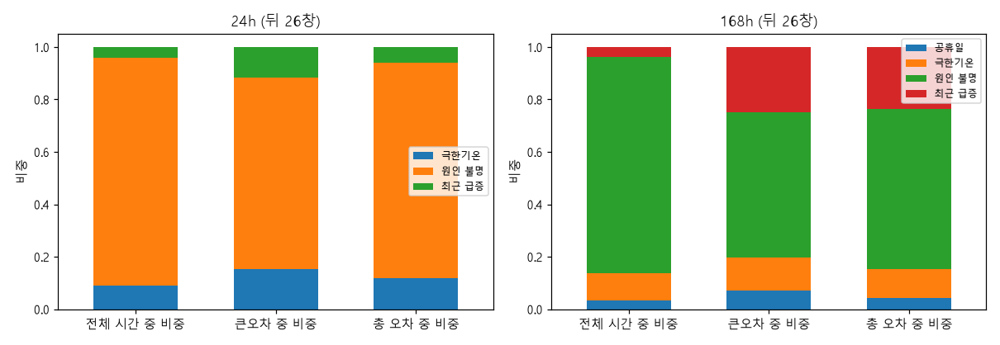
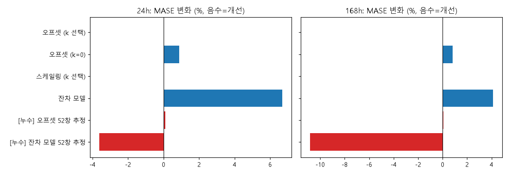

# 주간 보고서 — 11주차

## 1. 기본 정보
- 주차 / 기간: 11주차, 2026-11-08 ~ 2026-11-10
- 작성자: 김동호
- 실습시간: 계획 8h / 실제 12h

## 2. 이번 주 목표
1. 예측 오차가 큰 칸을 원인별(극한 기온 / 공휴일 / 최근 급증 / 원인 불명)로 분류하고, 오프셋·스케일링·잔차 모델 보정을 앞 구간에서만 추정해 뒤 구간 MASE의 보정 전후 변화를 측정한다.
2. 예측 1건에 대해 예측값, SHAP 기여 요인, 이상 상태를 구조화된 JSON으로 모아 설명문을 생성하고, 문장 속 모든 수치를 원본과 대조하는 자동 검증기로 이벤트 3건의 불일치율을 측정한다.

## 3. 수행 내역

|   | 과제 | 산출물 |
|---|---|---|
| 1 | 11-1. 이벤트 구간 식별 | `event_causes.csv`, `event_causes.png`, `event_top20.csv` |
| 2 | 11-2. 오차 보정 (3방식 + 누수 대조군) | `correction_k_selection.csv`, `correction_comparison.csv`/`.png`, `leak_checks.csv`, `src/correction.py` |
| 3 | 11-3. 근거 데이터 구조화 | `evidence_events.json` (`src/explain.py: build_evidence`) |
| 4 | 11-4. 설명문 생성 | `reports_v1.csv`, `reports_v2.csv`, `prompts.json` |
| 5 | 11-5. 자동 사실성 검증기 | `src/explain.py: verify`, `verification_table.csv` |
| 6 | 11-6. 프롬프트 개선 루프 | 위 표의 v1 → v2, `llm_cost.csv` |
| - | 노트북 (CPU, LLM은 API) | `notebooks/wk11_correction_explain.ipynb` |

## 4. 정량 결과

### 4-1. 이벤트 구간 식별 (과제 11-1, 뒤 26창)

큰 오차 = 정규화 오차(|오차| ÷ Naive 분모)가 앞 26창 95% 분위수(24h 1.100 / 168h 2.284) 초과인 시간.

| horizon | 원인 | 시간 수 | 큰 오차 | 큰 오차 비율 | 전체 시간 중 | 큰 오차 중 | 총 오차 중 |
|---|---|---|---|---|---|---|---|
| 24h | 극한 기온 | 950 | 89 | 9.4% | 9.0% | 15.4% | 11.9% |
| 24h | 최근 급증 | 422 | 68 | 16.1% | 4.0% | 11.8% | 6.1% |
| 24h | 원인 불명 | 9,236 | 420 | 4.6% | 87.1% | 72.8% | **82.0%** |
| 168h | 공휴일 | 2,448 | 305 | 12.5% | 3.3% | 7.1% | 4.2% |
| 168h | 극한 기온 | 7,646 | 537 | 7.0% | 10.3% | 12.6% | 11.2% |
| 168h | **최근 급증** | 2,714 | 1,070 | **39.4%** | 3.7% | **25.0%** | **23.7%** |
| 168h | 원인 불명 | 61,448 | 2,367 | 3.9% | 82.8% | 55.3% | 60.9% |

### 4-2. 오차 보정 (과제 11-2, 뒤 26창)

**보정 강도 선택 (앞 26창 안에서만, 검증 정규화 MAE 최소)**: 24h 오프셋 · 스케일링 모두 **k = 1e9 (보정 없음)** / 168h 오프셋 k = 50, 스케일링 k = 1e9 (보정 없음).

| horizon | 방식 | MASE | 기준 대비 | 이벤트 시간 정규화 MAE | 이벤트 기준 대비 | 개선/악화 건물 | Wilcoxon p |
|---|---|---|---|---|---|---|---|
| 24h | 기준 (보정 없음) | 0.3686 | — | 0.4898 | — | — | — |
| 24h | 오프셋 (k 선택) | 0.3686 | 0.00% | 0.4898 | 0.00% | 10 / 5 | 0.088 |
| 24h | 오프셋 (k=0, 수축 없음) | 0.3719 | **+0.9%** | 0.5264 | +7.5% | 5 / 10 | 0.036 |
| 24h | 스케일링 (k 선택) | 0.3686 | 0.00% | 0.4898 | 0.00% | 10 / 7 | 0.927 |
| 24h | 잔차 모델 | 0.3933 | **+6.7%** | 0.5262 | +7.4% | 4 / 13 | 0.001 |
| 24h | **[누수] 잔차 모델, 52창 추정** | 0.3553 | **−3.6%** | 0.4737 | −3.3% | 11 / 6 | 0.098 |
| 168h | 기준 (보정 없음) | 0.7689 | — | 0.8728 | — | — | — |
| 168h | 오프셋 (k 선택) | 0.7687 | −0.02% | 0.8717 | −0.12% | 9 / 8 | 0.678 |
| 168h | 오프셋 (k=0) | 0.7753 | +0.8% | 0.9197 | +5.4% | 5 / 12 | 0.057 |
| 168h | 스케일링 (k 선택) | 0.7689 | 0.00% | 0.8728 | 0.00% | 9 / 8 | 0.782 |
| 168h | 잔차 모델 | 0.8005 | **+4.1%** | 0.8601 | −1.5% | 8 / 9 | 0.579 |
| 168h | **[누수] 잔차 모델, 52창 추정** | 0.6855 | **−10.8%** | 0.7945 | −8.9% | 14 / 3 | 0.023 |

(이벤트 시간 = 뒤 26창에서 상황이 평시가 아닌 시간: 24h 950시간 / 168h 10,094시간. [누수] 오프셋 52창 추정은 24h +0.1% / 168h +0.1%라 표에서 생략, `correction_comparison.csv`에 있음.)

**누수 없음 검증 (`leak_checks.csv`)**

| 검사 | 24h | 168h |
|---|---|---|
| 추정에 쓴 마지막 시각 < 첫 평가 origin (2017-07-09) | 2017-07-02 23:00, 통과 | 2017-07-02 23:00, 통과 |
| 뒤 26창 정답을 무작위로 섞어도 오프셋 · 스케일 · 잔차 모델 · 선택 k 동일 | 전부 동일 | 전부 동일 |

### 4-3. 근거 구조화와 설명문 (과제 11-3~11-5)

선택된 이벤트 3건 (24h, 뒤 26창, 원인별 최대 오차, 서로 다른 건물):

| # | 원인 | 건물 | 예측 시각 | 예측값 (kWh) |
|---|---|---|---|---|
| 1 | 극한 기온 | Fox_office_Vicki | 2017-08-27 12:00 | 86.5 (외기온 40.0) |
| 2 | 최근 급증 | Bull_office_Sally | 2017-11-26 18:00 | 1,522.5 (직전 1주 Naive MASE 3.62) |
| 3 | 원인 불명 | Fox_office_Joy | 2017-07-30 23:00 | 187.5 |

JSON 스키마: `prediction`(값, 구간, 사용 모델, 라우팅 이유) · `shap_top_features`(상위 3) · `shap_note`(대리 모델 명시) · `covariates` · `anomaly_status` · `historical_analogue`. 정답(실측)은 넣지 않음. 전체 예시는 `evidence_events.json`.

**사실성 검증 (이벤트당 3회 호출 합산, 최종 검증기 기준)**

| 항목 | v1 이벤트 1 | v1 이벤트 2 | v1 이벤트 3 | **v1 합계** | v2 이벤트 1 | v2 이벤트 2 | v2 이벤트 3 | **v2 합계** |
|---|---|---|---|---|---|---|---|---|
| 생성 문장 내 수치 개수 | 21 | 23 | 35 | **79** | 35 | 55 | 40 | **130** |
| 원본과 일치 | 21 | 23 | 35 | 79 | 35 | 55 | 40 | 130 |
| 불일치 | 0 | 0 | 0 | **0 (0.0%)** | 0 | 0 | 0 | **0 (0.0%)** |
| 근거 없는 주장 | 3 | 3 | 2 | **8 (회당 0.89)** | 0 | 0 | 0 | **0 (회당 0)** |

v1의 근거 없는 주장 8건 (9회 중 8회에서 발생): "40도 이상"(JSON 값은 40.0, 이벤트 1의 3회 모두), "오늘은 공휴일이 아닙니다"(JSON에 없는 상대 시점, 이벤트 2의 3회와 이벤트 3의 2회).

### 4-4. 프롬프트 개선 (과제 11-6)

| 항목 | v1 | v2 |
|---|---|---|
| 지시 | 제공된 수치만 사용, 없는 정보 언급 금지, 5문장 이내 | v1 실패 근거로 6개 규칙 추가: 수치 그대로 옮김(한정어 금지), 피처 이름 그대로 표기, forecast_time 사용 + 상대 시점 금지, JSON에 없는 원인·권고 금지, SHAP이 대리 모델 기준임을 명시, 상태값 그대로 언급 |
| 수치 불일치율 | 0.0% (0/79) | 0.0% (0/130) |
| 근거 없는 주장 (회당) | 0.89 | **0** |
| 호출 / 비용 | 9회 / $0.0014 | 9회 / $0.0021 |

호출 총 18회, 입력 11,292 / 출력 3,029 토큰, **$0.0035**, 평균 호출 지연 2.9s. 노트북 실행 전 개발 중 이벤트 3건으로 9회를 더 호출(토큰은 기록하지 않음)했으므로 이번 주 LLM 호출 합계는 27회.

## 5. 해석

**11-1.**
- 이름을 붙일 수 있는 원인(공휴일·극한 기온·최근 급증)은 **총 오차의 18%(24h) / 39%(168h)** 만 설명하고, 나머지 82% / 61%는 "원인 불명"으로 남음. 큰 오차를 "이벤트"로 분류해도 대부분은 분류 기준 밖에서 발생.
- 비율로는 **최근 급증이 압도적**: 168h에서 시간의 3.7%인데 큰 오차의 25%, 총 오차의 23.7%. 큰 오차 비율도 39.4%로 다른 원인(3.9~12.5%)보다 3~10배 높음. 10주차에서 확인한 11월 Bull 급증과 같은 현상.
- 극한 기온 · 공휴일은 큰 오차 비율이 기준(4~5%)보다 높지만(7~12.5%) 총 오차 기여는 4~12%로 작음.

**11-2.**
- **보정은 이 데이터에서 효과가 없음**: 앞 26창 안의 검증이 24h 오프셋·스케일링 모두 "보정 없음"을 선택했고(24h 점수 변화 0.00%), 168h 오프셋만 약하게 선택돼 −0.02%(p = 0.68)로 노이즈 범위. 수축을 끈 오프셋(k=0)과 잔차 모델은 오히려 나빠짐(+0.8~+6.7%).
- 원인 추정(가설, 별도 검증 안 함): 기준 모델이 이미 24h MASE 0.37로 강해서 앞 구간(1~6월)에서 추정할 만한 체계적 편향이 작고, 뒤 구간(7~12월)에서는 편향이 달라졌을 가능성. 잔차 모델이 악화한 것은 앞 구간 패턴이 뒤로 이어지지 않는다는 뜻과 일치.
- **누수 보정은 점수를 크게 부풀림**: 같은 잔차 모델을 52창 전체로 추정하면 24h −3.6%, 168h −10.8%(p = 0.023, 14/17 건물 개선)로 "개선"이 나옴. 정직하게 추정한 같은 모델은 +6.7% / +4.1%. 교재의 "보정으로 전체 성능이 크게 개선되면 누수를 의심하라"가 그대로 재현됨. 168h에서 누수 보정의 이득이 큰 이유는 뒤 구간의 정답이 추정에 들어가 11월 급증까지 학습하기 때문으로 보이나, 원인 분해는 하지 않음.
- 누수 없음 검증 2가지(마지막 시각, 평가 정답을 섞어도 파라미터 동일)를 모두 통과.

결과: 보정 3방식 모두 정직한 평가에서 이득 없음. "이 17개 건물 · 이 기준 모델에서 보정은 불필요"가 데이터가 말하는 결론.

**11-3~11-5.**
- 교재가 "거의 항상 발생한다"고 한 첫 프롬프트의 **수치 불일치가 이번에는 0%**(0/79). 근거 JSON에 수치가 이미 계산되어 있고 모델이 그대로 옮겼기 때문. 실패는 수치가 아니라 **근거 없는 주장**(값을 부풀린 한정어 "40도 이상", JSON에 없는 상대 시점 "오늘")에서 나옴.
- 검증기에서 발견된 문제: 처음 버전은 `lag_168`을 설명하며 쓴 "168시간"을 수치 불일치로 셌음(이벤트 3, 개발 중 호출 3회). 문장 속 숫자가 피처 이름에서 온 것이라 오탐이므로 피처·모델명 속 숫자를 근거로 인정하도록 수정. "40도 이상" 같은 한정어는 개발 중 호출에서 본 뒤 규칙으로 추가함. 즉 **검증기 자체를 v1 결과를 보고 고쳤음**(최종 검증기를 v1, v2 양쪽에 똑같이 적용해 비교).

**11-6.**
- v1 → v2: 근거 없는 주장 회당 0.89 → 0, 수치 불일치율은 0 → 0. **불일치율이 0으로 나온 것은 "정확하다"가 아니라 "이 검증기가 잡는 범위에서는 위반이 없다"는 뜻**.
- 검증기가 못 잡는 오류가 실제로 있음: v2 이벤트 2 설명문 일부는 "이 예측 모델은 LightGBM 대리 모델을 사용하며"라고 써서, 실제 예측 모델(Chronos-2 + 공변량)과 SHAP 설명용 대리 모델을 혼동함. 수치·어휘 검사로는 통과함 → 의미 오류는 사람이 읽어야 함.
- v2는 규칙 준수가 강해진 대신 문장이 JSON 필드명 나열(`is_anomaly가 false이며, recent_residual_level은 normal`)에 가까워져 **설비 담당자가 읽기에는 어색**함. 불일치율만 낮추면 가독성이 떨어지는 트레이드오프.
- 이벤트 3건 · 3회로 측정했고, 프롬프트 개선에 쓴 이벤트와 평가 이벤트가 같으므로 v2의 0은 이 3건에 맞춘 값일 수 있음 (일반화는 미검증).

## <자가점검 리스트>

**1. 보정이 성능을 개선했는가? 개선했다면 누수가 아님을 어떻게 확신하는가?**
- 개선하지 않음 (24h 0.00%, 168h −0.02%, 모두 노이즈). 유일한 "개선"은 52창으로 추정한 누수 보정(24h −3.6%, 168h −10.8%)이며 이는 일부러 만든 대조군. 정직한 보정에 대해서는 ① 추정에 쓴 마지막 시각(2017-07-02 23:00) < 첫 평가 origin(2017-07-09), ② 평가창 정답을 섞어도 파라미터 불변을 확인.

**2. 첫 프롬프트에서 불일치율은 몇 %였는가? 개선 후에는?**
- 수치 불일치율 v1 0.0% (0/79) → v2 0.0% (0/130). 근거 없는 주장은 회당 0.89 → 0. 처음 버전의 검증기에서는 "168"이 3회 불일치로 잡혔으나 피처 이름 속 숫자를 오탐한 것으로 판단해 고쳤음.

**3. 설명문을 설비 담당자에게 보여줬다고 상상해 보라. 그는 무엇을 하러 갈 것인가?**
- 이벤트 2(Bull_office_Sally)는 "이상 상태, 최근 잔차 수준 높음"이 나와 해당 건물을 확인하러 갈 것으로 보임. 이벤트 1·3은 "정상 범위"만 알려 주고 **무엇을 해야 하는지는 설명문에 없음**(JSON에 없는 권고를 막았기 때문). SHAP 기여도(`lag_24` −127.88 등)는 예측 모델이 아니라 대리 모델 기준이라 현장 담당자가 행동으로 옮기기 어려움.

**4. 이 시스템을 실제 배포한다면, 검증기가 불일치를 발견했을 때 어떻게 동작해야 하는가?**
- 수치 불일치는 해당 문장을 지우거나 JSON 값으로 되돌려 쓴 뒤 재검증, 근거 없는 주장 어휘가 나오면 재생성(최대 N회), 계속 실패하면 설명문을 내보내지 않고 JSON 기반의 정형 템플릿 문장으로 대체하는 것이 안전. 검증기가 잡지 못하는 의미 오류(예: 대리 모델과 예측 모델 혼동)가 있으므로 정형 템플릿 병행이 필요하다는 점이 이번 측정에서 확인됨. (실제 구현은 하지 않음)

## 6. 막힌 점

| 문제 | 가설 | 검증 방법 | 결과 |
|---|---|---|---|
| 보정이 3방식 모두 개선되지 않음 | 기준 모델이 강해서 남은 체계적 편향이 작고, 앞·뒤 구간 편향이 다름 | 앞 26창 안에서 수축 k 검증 선택, 누수 대조군과 비교 | 확인. 정직한 보정은 이득 없음, 누수 보정만 개선처럼 보임 |
| "40도 이상" 같은 값 부풀리기를 검증기가 못 잡음 | 수치는 일치하지만 한정어가 의미를 바꿈 | 개발 중 출력 읽기 | 한정어 규칙 추가. **검증기를 v1 결과를 본 뒤 고쳤으므로 그 한계를 기록** |
| 24h 뒤 26창에 공휴일이 없음 | 평가 윈도우가 주 1회 24시간이라 공휴일을 거의 안 지남 | 상황별 시간 수 확인 | 확인. 24h 공휴일 보정은 평가 불가 (168h에서만 2,448시간) |

## 7. 다음 주 목표
12주차는 주간 보고서 대신 종합 보고서가 대체함. 교재 기준으로 ① 12주 누적 비교표(빈칸은 각주로 이유 기록), ② 최종 보고서 5절(네 가지 함정) — 평가 설계 · 누수 · 사전학습 오염 · 보정/라우팅의 가짜 개선 사례 정리, ③ README 재현 절차, ④ 발표