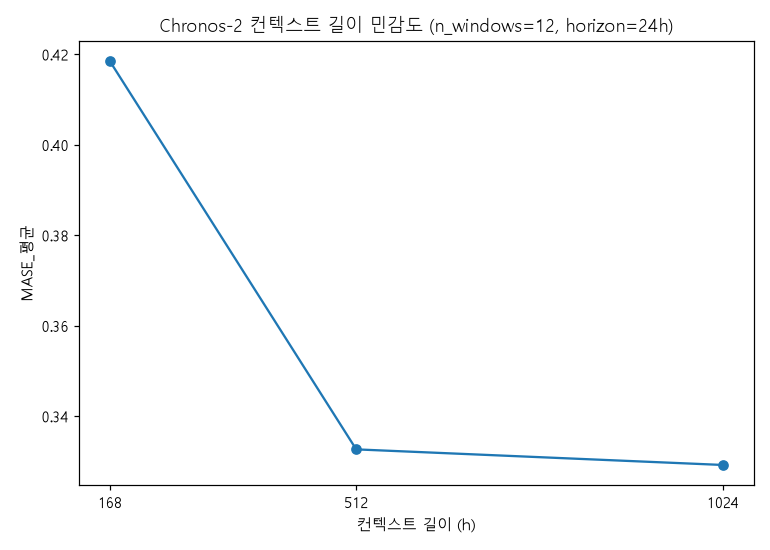
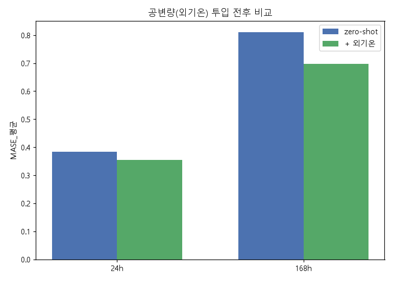
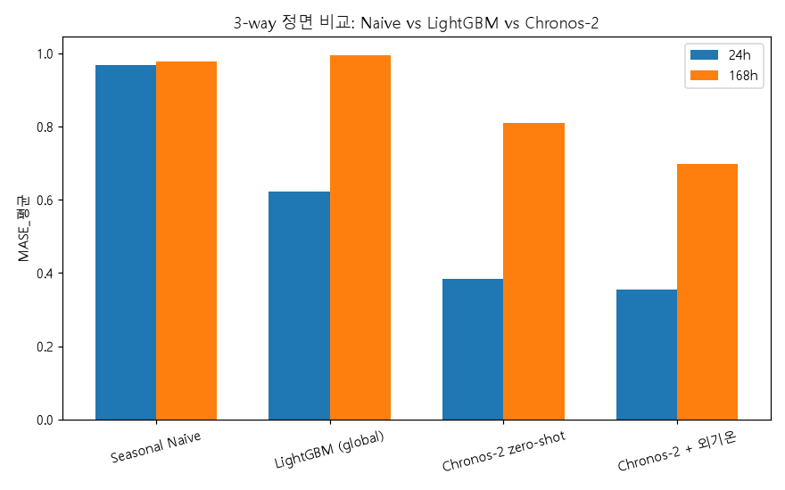
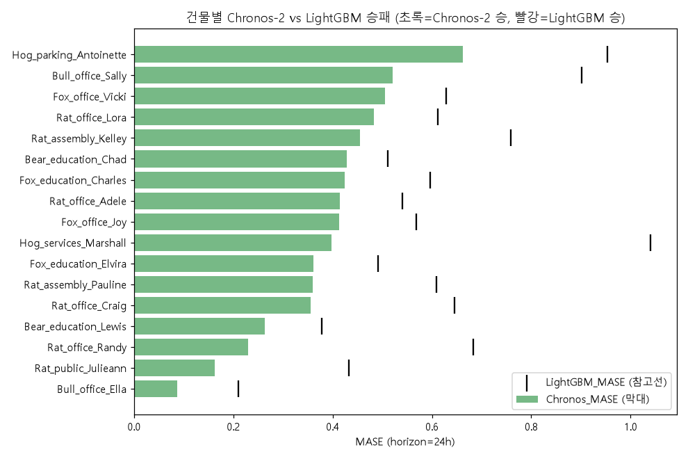

# 주간 보고서 — 5주차

## 1. 기본 정보
- 주차 / 기간: 5주차, 2026-09-22 ~ 2026-09-29
- 작성자: 김동호
- 실습시간: 계획 8h / 실제 16h

## 2. 이번 주 목표
1. Chronos-2 zero-shot을 2주차 하네스에 통합해 실행한다.
2. 컨텍스트 길이·공변량(외기온) 투입 전후의 성능 차이를 측정한다.
3. Naive / LightGBM / Chronos-2를 정면 비교하고 판정한다.

## 3. 수행 내역

|   | 과제 | 산출물 |
|---|---|---|
| 1 | Chronos-2 하네스 통합 | `notebooks/wk05_Chronos-2 zero-shot.ipynb` |
| 2 | 컨텍스트 길이 민감도 | `results/wk5/context_length_sensitivity.csv` |
| 3 | 공변량(외기온) 비교 | `results/wk5/covariate_gain.csv` |
| 4 | 3-way 비교 + 건물별 승패 | `results/wk5/three_way_comparison.csv`, `per_building_win_loss.csv` |
| 5 | 승패 원인 분석 | `results/wk5/win_loss_by_usage.csv` |
| 6 | CPU 추론 시간 측정 | `results/wk5/cpu_timing.csv` |

## 4. 정량 결과  

### 4-1. 컨텍스트 길이 민감도 (n_windows=12, horizon=24h)

| 컨텍스트 길이 | MASE_평균 |
|---|---|
| 168h | 0.4185 |
| 512h | 0.3327 |
| **1024h** | **0.3292** |

512h 부근에서 사실상 포화(512→1024h는 -1.1%뿐) → 이후 실험은 1024h로 고정

### 4-2. 공변량(외기온) 투입 전후

| horizon | zero-shot | +외기온 | 개선율 |
|---|---|---|---|
| 24h | 0.3837 | 0.3545 | 7.6% |
| 168h | 0.8100 | 0.6969 | **14.0%** |

### 4-3. 3-way 정면 비교

| 모델 | horizon 24h | horizon 168h |
|---|---|---|
| Seasonal Naive | 0.967 | 0.977 |
| LightGBM (global) | 0.621 | 0.996 |
| Chronos-2 zero-shot | 0.384 | 0.810 |
| **Chronos-2 + 외기온** | **0.355** | **0.697** |

**건물별 승패(horizon=24h, 168h 둘 다): Chronos-2 17승 0패** — 전 건물에서 승리

**공정성 재검증**: LightGBM이 외기온을 안 썼다는 점이 걸려, LightGBM에도 외기온+이슬점을 추가해 같은 52-window로 다시 학습·평가했다

| 모델 | horizon 24h | horizon 168h |
|---|---|---|
| LightGBM (외기온 없음) | 0.621 | 0.996 |
| LightGBM (외기온 추가) | 0.612 | 1.006 |

외기온을 추가해도 24h는 1.5%만 개선, 168h는 오히려 1.1% 악화 — **Chronos-2 zero-shot(0.384/0.810)조차 외기온을 추가한 LightGBM(0.612/1.006)보다 크게 앞선다.** 5-4의 결과가 공변량 격차로 인한 착시가 아님을 확인

### 4-4. 승패 원인 — 용도·면적별 개선율

| 용도 | 건물수 | 평균 개선율(%) |
|---|---|---|
| Public services | 1 | 62.4 |
| Services | 1 | 61.8 |
| Entertainment/public assembly | 2 | 40.4 |
| Office | 8 | 37.9 |
| Parking | 1 | 30.6 |
| Education | 4 | 25.5 |

sqm(면적) vs 개선율 상관계수: **-0.53**

### 4-5. CPU 추론 시간 (건물 1개, horizon=24h, 스레드 4개, 5회 독립 측정의 최소/중앙값/최대)

최초 측정(1회)이 교재 검산값과 반대 방향으로 나와 이상하다고 판단, 별도 프로세스에서 4회 더 재측정했다. 그 결과 이 노트북에서는 같은 코드·같은 조건에서도 실행마다 최대 2.7배까지 편차가 있다는 것을 확인해, 단일 수치 대신 범위로 기록했다.

| 방식 | 최소 | 중앙값 | 최대 |
|---|---|---|---|
| LightGBM - recursive (24스텝 순차) | 470.8ms | 1186.1ms | 1285.3ms |
| LightGBM - direct (24행 배치) | 22.3ms | 60.0ms | 64.3ms |
| Chronos-2 zero-shot (ctx=1024h) | 193.2ms | 341.8ms | 419.5ms |

중앙값 기준 배수: Chronos÷recursive ≈ 0.29(참고치, 편차 큼), Chronos÷direct ≈ 5.7

## 5. 해석

**5-2.**
- 168h→512h는 크게 개선(0.4185→0.3327, -20.5%)되지만 512h→1024h는 거의 정체(-1.1%)
- 모델의 최대 컨텍스트(8192h)에 비하면 우리 데이터의 유의미한 패턴(일간·주간 주기)은 이미 512 ~ 1024h(3 ~ 6주) 안에 대부분 담기는 것으로 판단

결과: 512h 부근에서 사실상 포화, 이후 실험은 1024h로 고정

**5-3.**
- 24h는 7.6%, 168h는 14.0% 개선 — 168h에서 개선폭이 24h보다 약 2배 큼
- 예측 구간이 길어질수록 컨텍스트만으로는 알 수 없는 "그 시점의 실제 기후"가 예측에서 차지하는 비중이 커진다고 판단
- 24h 앞은 어제·오늘 패턴만으로도 어느 정도 맞지만, 168h 앞은 그 사이 날씨 변화를 컨텍스트만으론 알 수 없어 외기온을 직접 주면 그 공백이 메워짐

결과: 외기온 공변량으로 두 horizon 모두 개선, horizon이 길수록 효과가 큼

**5-4.**
- 두 horizon 모두, 17개 건물 전부에서 Chronos-2가 LightGBM을 이김 — 교재가 말하는 결과(이력 충분하면 LightGBM 승)와 반대
- 판정 기준표상 정상 범위지만 17/17 전승은 이례적이라 판단해 원인을 두 갈래로 재검증 진행
  1. LightGBM에 외기온이 없어서 불공정한 비교였는가 → LightGBM에도 외기온+이슬점을 추가해 같은 52-window로 재학습. 24h는 겨우 1.5% 개선(0.621→0.612), 168h는 오히려 1.1% 악화(0.996→1.006) — 격차가 거의 안 줄어 공변량 문제가 아니었음을 확인
  2. 외기온 없는 Chronos-2 zero-shot(0.384/0.810)조차 외기온을 추가한 LightGBM(0.612/1.006)보다도 크게 앞섬 → 공변량 격차가 아니라 두 모델 계열 자체의 실력 차이로 판단

결과: Chronos-2의 17승이 공변량 격차로 인한 착시가 아님을 확인, 원래 결론 유지

**5-5.**
- 용도별로 봐도 전 건물이 Chronos-2 승이라 개선율(격차 크기)로 나눠서 봄
- sqm(면적)과 개선율의 상관계수 -0.53 — 건물이 클수록 Chronos-2 우위가 작아짐
- 개선율 최하위 2곳(`Bear_education_Chad` 16.1%, `Rat_office_Adele` 23.2%)은 17개 건물 중 가장 큰 두 곳(각각 39,102㎡·37,904㎡)이고, 최상위(`Rat_office_Randy` 66.4%)는 중간 크기(5,779㎡)
- 큰 건물은 자체 이력만으로도 LightGBM이 패턴을 학습할 여지가 있는 반면, 작고 단순한 건물(주차장·공공서비스 등)은 LightGBM이 과적합하기 쉬워 Chronos-2의 범용 사전학습 패턴이 상대적으로 더 안정적이라고 판단

결과: 건물이 작고 단순할수록 Chronos-2의 우위가 큼

**5-6.**
- 처음 측정에서 recursive가 1285.3ms로 나와 교재 검산값(Chronos-2가 recursive보다 2~5배 느려야 정상)과 반대 방향이 나옴 — 이상하다고 판단해 재검증
- 단일 프로세스 안에서 프로파일링한 결과 recursive 시간의 77%가 매 스텝 `build_features()` 전체 재계산 비용이라는 구조적 원인은 재확인됨 — recursive가 direct·Chronos-2보다 느린 것 자체는 확인

결과: 이 노트북에서는 몇 배 느린가를 정확히 확정하기 어려워 5회 측정의 최소/중앙값/최대 범위로 대신 기록. "recursive가 가장 느리다"는 방향성만 신뢰할 수 있는 결론이라 판단

------------------------------------------------------------------------------------------------------------------------------

## <자가점검 리스트>

**자가 점검 1. Chronos-2가 LightGBM을 이겼는가? 어느 조건에서 이겼는가?**
- 두 horizon(24h/168h) 모두, 17개 건물 전부에서 이김
- 공변량을 더하면 격차가 더 벌어짐(24h: 0.384→0.355, 168h: 0.810→0.697)

**자가 점검 2. 공변량을 넣은 Chronos-2와 LightGBM 중 어느 쪽이 외기온을 더 잘 쓰는가?**
- 이 비교 자체가 완전히 공정하지는 않다는 점을 먼저 밝힘 — LightGBM(3주차)은 원래 외기온을 안 쓰고 비교됨
- 그래서 공정성 재검증으로 LightGBM에도 외기온을 추가해봤더니 24h는 1.5%만 개선, 168h는 오히려 1.1% 악화
- Chronos-2는 같은 외기온 추가로 24h 7.6%, 168h 14.0% 개선 — **Chronos-2 쪽이 외기온을 훨씬 더 잘 쓴다**고 판단

**자가 점검 3. 만약 Chronos-2가 졌다면, 그것은 모델이 나쁘다는 뜻인가 아니면 다른 뜻인가?**
- 이번 실험에서는 진 경우가 없어 해당 사항 없음
- 다만 만약 졌다면, 모델의 결함이라기보다 그 건물의 소비 패턴이 일반적 전력 소비 패턴과 거리가 멀거나, 그 건물만의 안정적인 장기 이력이 있어 LightGBM이 그 특이성을 학습할 여지가 컸다는 뜻에 더 가까울 것으로 판단

**자가 점검 4. 추론이 N배 느리다면, 성능 개선폭이 그것을 정당화하는가? 어떤 현장에서 정당화되고 어떤 현장에서 안 되는가?**
- direct(배치) 기준 대략 5.7~6.8배 느리지만, MASE는 24h에서 38%p, 168h에서 30%p 개선됨
- 건물 수가 적고 실시간성이 크게 중요하지 않은 현장이라면 이 정도 지연은 문제가 되지 않아 Chronos-2가 정당화됨
- 반대로 수백~수천 건물을 1분 주기로 갱신해야 하는 현장이라면 이 지연이 누적되어 문제가 될 수 있음

## 6. 막힌 점

| 문제 | 가설 | 검증 방법 | 결과 |
|---|---|---|---|
| Chronos-2 17승이 "LightGBM에 공변량을 안 줬기 때문"일 수 있다는 의심 | LightGBM에 외기온을 추가하면 격차가 크게 줄어들 것 | LightGBM에도 외기온+이슬점을 추가해 동일 52-window로 재학습·평가(`results/wk5/lgb_weather_summary.csv`) | 가설 기각 — 24h는 1.5%만 개선, 168h는 오히려 1.1% 악화. 공변량 격차가 원인이 아니었음을 확인, 원래 결론 유지 |

## 7. 다음 주 목표
1. 경량 TSFM의 CPU 실행 가능성을 확인한다.
2. 5주차까지의 전체 모델을 종합 비교하는 1단계 통합 보고서를 준비한다.

## 8. 질문
- 이번 주차에는 없습니다.