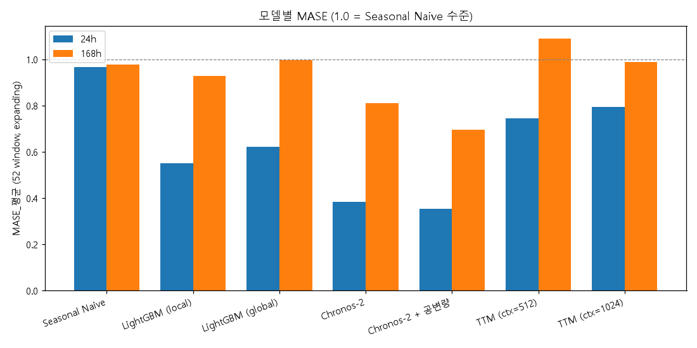
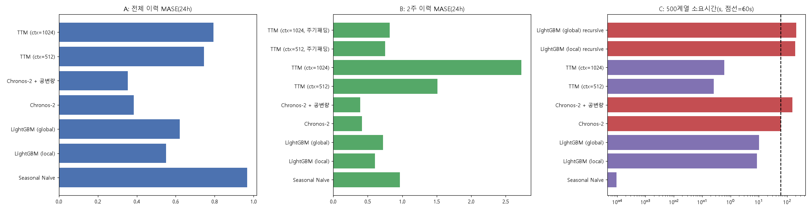

# 주간 보고서 — 6주차

## 1. 기본 정보
- 주차 / 기간: 6주차, 2026-09-29 ~ 2026-10-12 
- 작성자: 김동호
- 실습시간: 계획 8h / 실제 16h

## 2. 이번 주 목표
1. 경량 TSFM의 CPU 실행 가능성을 확인한다.
2. 5주차까지의 전체 모델을 종합 비교하는 1단계 통합 보고서를 준비한다.

## 3. 수행 내역

|   | 과제 | 산출물 |
|---|---|---|
| 1 | 6-1. TTM 라우팅 확인 + 백테스트 | `notebooks/wk06_TTM_benchmark.ipynb`, `results/wk6/ttm_routing_check.csv`, `ttm_vs_chronos.csv` |
| 2 | 6-2. 전체 벤치마크 | `results/wk6/benchmark_table.csv`, `raw_measure/*.json` |
| 3 | 6-3. 6축 판단표 + 시나리오 선택 | `results/wk6/six_axis_table.csv`, `scenario_choices.csv`, `scenario_summary.png` |

## 4. 정량 결과

### 4-1. TTM 체크포인트 라우팅 (과제 6-1)

| 컨텍스트 | 요청 horizon | 선택된 체크포인트 | 잘라내기 경고 | freq prefix tuning |
|---|---|---|---|---|
| 512 | 24 | `512-48-ft-r2.1` | 있음 | **True → `freq_token` 필요** |
| 512 | 168 | `512-192-r2` | 있음 | False |
| 1024 | 24 | `1024-96-r2` | 있음 | False |
| 1024 | 168 | `1024-192-r2` | 있음 | False |

`freq_token`을 안 주면 `Expecting freq_token in forward`, hourly(=7)를 주면 정상 실행

### 4-2. TTM vs Chronos-2 (52 windows)

| horizon | TTM | TTM MASE | Chronos-2 MASE | Chronos-2 승 / TTM 승 (건물) |
|---|---|---|---|---|
| 24h | ctx=512 | 0.745 | 0.384 | 17 / 0 |
| 24h | ctx=1024 | 0.793 | 0.384 | 17 / 0 |
| 168h | ctx=512 | 1.090 | 0.810 | 15 / 2 |
| 168h | ctx=1024 | 0.990 | 0.810 | 14 / 3 |

### 4-3. 전체 벤치마크 (과제 6-2)

측정 방식: **direct**(recursive는 별도 열), 스레드 4개, 프로세스 3개 × 11회 중 첫 호출 제외 후 중앙값

| 모델 | MASE(24h) | MASE(168h) | 추론 ms/계열 | recursive ms/계열 | 학습(s) | RAM baseline→피크(MB) |
|---|---|---|---|---|---|---|
| Seasonal Naive | 0.967 | 0.977 | 0.07 | — | — | 445 → 445 |
| LightGBM (local) | 0.550 | 0.930 | 17.8 | 480 | 4.3 | 445 → 452 |
| LightGBM (global) | 0.621 | 0.996 | 25.3 | 545 | 6.0 | 445 → 452 |
| Chronos-2 | 0.384 | 0.810 | 154.7 | — | — | 446 → 916 |
| Chronos-2 + 공변량 | 0.355 | 0.697 | 294.1 | — | — | 447 → 959 |
| TTM (ctx=512) | 0.745 | 1.090 | 4.4 | — | — | 445 → 456 |
| TTM (ctx=1024) | 0.793 | 0.990 | 5.0 | — | — | 446 → 464 |

### 4-4. 시나리오 A/B/C (과제 6-3)

| 시나리오 | 선택 | 결정적 근거 |
|---|---|---|
| A (이력 2년, 온프렘, 50개) | Chronos-2 + 공변량 | 50계열 1회 추론 15s로 1시간 주기 충족, 충족 모델 중 MASE(24h) 최저(0.355) |
| B (신규 준공, 이력 2주) | Chronos-2 + 공변량 | 2주 이력만으로 MASE(24h) 0.392(최저). 같은 조건에서 LightGBM(global) 0.721, TTM(512) 1.510(기본 제로패딩) |
| C (RAM 4GB·2코어, 500계열·1분) | LightGBM (local) | 500계열 8.6s·RAM 669MB로 충족. Chronos-2는 RAM 2.1GB로 4GB엔 올라가지만 500계열 60s로 1분 초과 |

## 5. 해석

**6-1.**
- 24h에서만 `freq_token` 오류가 나는 이유: 요청 24h에 맞춰 `512-48-ft-r2.1`(주파수 프리픽스 튜닝 리비전)이 선택되기 때문. 168h는 프리픽스 튜닝이 없는 리비전(`512-192-r2`)이 선택되어 오류가 없음
- 모든 조합에서 체크포인트 예측 길이(48/96/192)와 요청 horizon이 달라 잘라내기 경고가 발생 → 24h 예측은 24h 전용 모델의 예측과 같지 않음
- 정확도는 TTM이 Chronos-2보다 낮음 (24h MASE 0.745 vs 0.384, 168h는 TTM이 Naive보다도 나쁨)

결과: TTM은 정확도는 낮고 속도는 빠른 모델 — 판정 기준표상 정상

**6-2.**
- 추론 속도: TTM 4.4ms vs Chronos-2 154.7ms로 약 35배 빠름 (검산값 30~40배 범위)
- 피크 RAM: TTM 456MB, Chronos-2 916MB로 약 절반 (둘 다 4GB 이내)
- LightGBM recursive(480~545ms)는 direct(18~25ms)의 약 20~30배

결과: 검산값과 방향·크기 모두 일치

**6-3.**
- A와 B는 같은 모델, C만 다름: A·B는 지연 제약이 느슨해 정확도가 결정적, C는 처리량(500계열·1분)이 결정적
- Chronos-2는 4GB에 올라가지만(2.1GB) 1분 안에 500계열을 못 끝냄 → RAM이 아니라 처리량이 탈락 사유
- TTM(500계열 0.26~0.60s)은 처리량은 충분하지만 MASE(24h) 0.745로 LightGBM(local) 0.550보다 낮아 C에서도 선택되지 않음
- 콜드스타트: TTM의 2주 이력 MASE는 기본 제로패딩에서 1.51/2.73이지만, 주기(168h) 패딩으로 바꾸면 0.753/0.821로 회복 → 라이브러리 기본 패딩이 원인

결과: 조건에 따라 답이 다름. 최신·최대 모델이 항상 좋은 것은 아님

## <자가점검 리스트>

**자가 점검 1. 세 시나리오에서 같은 모델을 골랐는가?**
- A·B는 Chronos-2 + 공변량, C는 LightGBM (local)
- 결정적 차이: C는 500계열을 1분 안에 처리해야 하는 처리량 제약

**자가 점검 2. 결론은 "최신 모델이 좋다"인가 "조건에 따라 다르다"인가?**
- 조건에 따라 다름. 조건: (1)이력이 짧거나 정확도가 최우선이면 Chronos-2(+공변량), (2)계열 수 × 갱신 주기가 CPU 처리량 한계를 넘으면 LightGBM

**자가 점검 3. 임원에게 5분 안에 설명한다면?**
- "예측 정확도는 Chronos-2가 가장 높지만 건물 50개 규모까지가 현실적이고, 500개 이상을 1분 주기로 돌리려면 LightGBM이 맞다. 신축 건물은 이력이 없어도 Chronos-2로 바로 시작할 수 있다."

## 6. 막힌 점

| 문제 | 가설 | 검증 방법 | 결과 |
|---|---|---|---|
| TTM 콜드스타트 MASE가 1.51 / 2.73으로 비정상적으로 큼 | 모델 한계가 아니라 짧은 컨텍스트의 패딩 방식 문제 | 부족한 구간을 168h 주기로 채우는 변형 추가 | 가설 확인 — 0.753 / 0.821로 회복 |
| 시나리오 C의 일부 값이 단일 계열 × 500 외삽 | 실측으로 대체 가능한 것은 대체 | 500계열 실측(Chronos-2, TTM, LightGBM local) | Chronos-2·TTM·LightGBM local은 실측. LightGBM global과 Chronos-2+공변량, recursive 2종은 외삽으로 남음 |

## 7. 다음 주 목표
1. GPU 환경 구축 및 7주차 과제 수행

## 8. 질문
- 이번 주차는 없습니다.