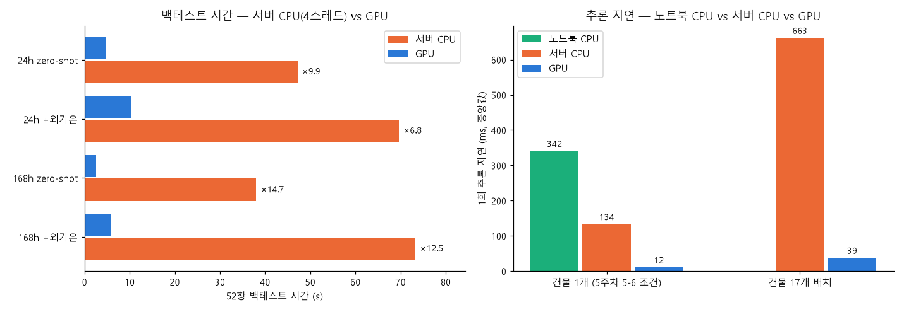
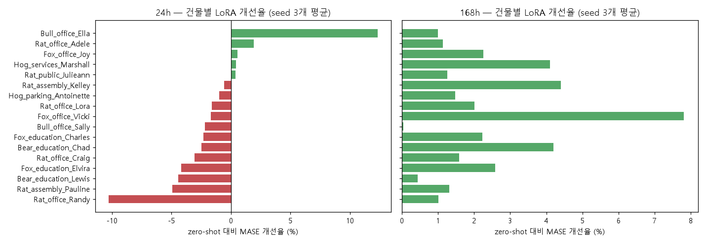
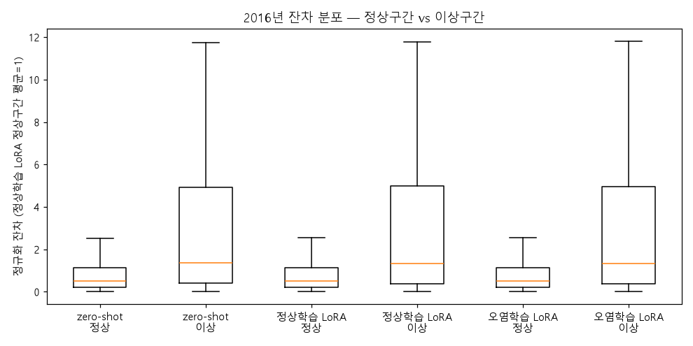
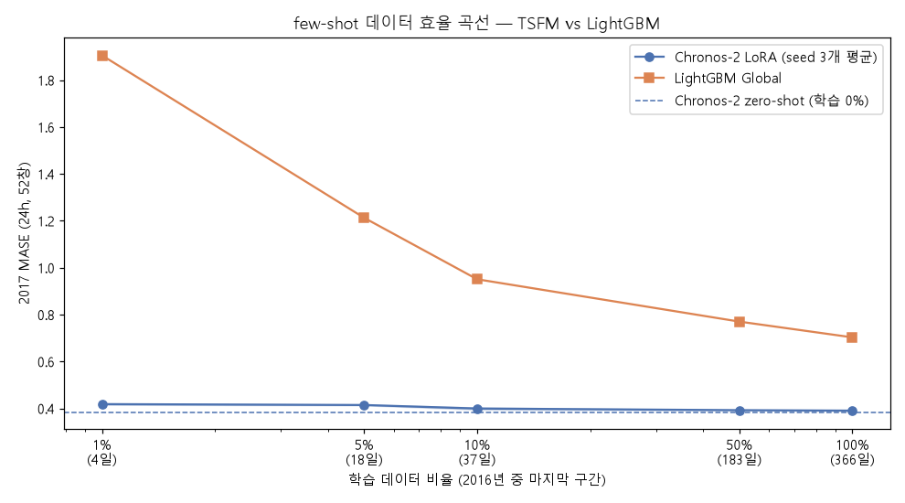

# 주간 보고서 — 7주차

## 1. 기본 정보
- 주차 / 기간: 7주차, 2026-10-27 ~ 2026-11-01
- 작성자: 김동호
- 실습시간: 계획 8h / 실제 12h

## 2. 이번 주 목표
1. GPU 서버(DGX Spark) 환경을 구축하고 5주차 Chronos-2 실험을 GPU에서 재현한다.
2. Chronos-2 / TimesFM 2.5 / Moirai 2.0의 사전학습 코퍼스에 BDG2가 포함되는지 문서로 검증한다.
3. Chronos-2를 LoRA로 파인튜닝하고 정상학습·오염학습·few-shot 조건을 비교한다.

## 3. 수행 내역

|   | 과제 | 산출물 |
|---|---|---|
| 1 | 7-1. 서버 환경 + CPU/GPU 비교 | `notebooks/wk07_LoRA.ipynb`, `results/wk7/gpu_reproduction.csv`, `latency_cpu_vs_gpu.csv`, `cpu_vs_gpu_summary.png` |
| 2 | 7-2. 오염 검증 문서 | 본 보고서 4-2 |
| 3 | 7-3. LoRA 파인튜닝 (정상학습) | `src/finetune.py`, `results/wk7/lora_summary.csv`, `lora_cost.csv`, `lora_per_building.png`, `fit_log.csv` |
| 4 | 7-4. 오염 학습 대조 | `results/wk7/contamination_performance.csv`, `contamination_residuals.csv`, `contamination_residuals.png` |
| 5 | 7-5. few-shot 효율 곡선 | `results/wk7/fewshot_curve.csv`, `fewshot_curve.png`, `lgb_fewshot_per_building.csv` |
| - | 분석 노트북 (CPU) | `notebooks/wk07_analysis.ipynb` |

**공통 실험 조건**
- 평가: 5주차와 동일 — 2017년 52창, step 168h, expanding, context 1024h, MASE(분모 = 계절 naive 168h)
- 파인튜닝 데이터: 2016년(LEAD 라벨 기간, 첫 평가 시점 2017-01-08 이전 → 누설 없음)
- 정상학습 = LEAD `anomaly==1` 시점(2.15%)을 NaN으로 가림 / 오염학습 = 가리지 않음
- LoRA: r=8, alpha=16 (q·k·v·o + 출력층), lr 1e-5, 1000 step, batch 64, seed 3개(0·1·2)

## 4. 정량 결과

### 4-1. 서버 환경 + CPU vs GPU (과제 7-1)

| 항목 | 값 |
|---|---|
| GPU | NVIDIA GB10 (DGX Spark, sm_121, aarch64), CUDA 13.0 |
| 소프트웨어 | Python 3.11 (uv venv), torch 2.10.0+cu130, chronos-forecasting 2.3.1, peft 0.21.2 |
| 5주차 재현 | MASE 4개 조건 모두 일치 (최대 차이 2.2e-8). 예측값 최대 차이 0.005 — 서버 CPU에서도 같은 크기로 나타나므로 x86↔ARM 부동소수점 차이 |

| 조건 (52창 백테스트) | 서버 CPU 4스레드 (s) | GPU (s) | GPU 배속 |
|---|---|---|---|
| 24h zero-shot | 47.2 | 4.7 | ×9.9 |
| 24h + 외기온 | 69.6 | 10.3 | ×6.8 |
| 168h zero-shot | 38.1 | 2.6 | ×14.7 |
| 168h + 외기온 | 73.3 | 5.9 | ×12.5 |

| 추론 1회 지연 (중앙값) | 노트북 CPU (5주차) | 서버 CPU | GPU | GPU 배속 (서버 CPU 대비) |
|---|---|---|---|---|
| 건물 1개 | 341.8ms | 134.1ms | 11.6ms | ×11.5 |
| 건물 17개 배치 | — | 662.7ms | 38.6ms | ×17.2 |

### 4-2. 사전학습 오염 검증 (과제 7-2)

| 모델 | 코퍼스 문서 위치 | BDG2 포함 여부 | 근거 | 본 과정 사용 가부 |
|---|---|---|---|---|
| Chronos-2 | 기술 보고서 [arXiv 2510.15821](https://arxiv.org/abs/2510.15821) §4.1 +  **부록 Table 6** / [모델카드](https://huggingface.co/amazon/chronos-2) "Training data" | **미포함** | Table 6의 실데이터 23종에 BDG-2 없음. 건물 관련은 Buildings 900K와 London Smart Meters. 모델카드의 "Subset of GIFT-Eval Pretrain"은 부분집합이며, 그 부분집합이 Table 6에 열거됨 | **사용 가능** |
| TimesFM 2.5 | [모델카드 google/timesfm-2.5-200m-pytorch](https://huggingface.co/google/timesfm-2.5-200m-pytorch) | **포함** | "pretrained using GiftEvalPretrain" — 부분집합 언급 없이 전체 사용.  | **배제** |
| Moirai 2.0 | 논문 [arXiv 2511.11698](https://arxiv.org/abs/2511.11698) **§4 Pretraining Datasets**  | **포함** | 5개 소스 중 첫째가 "Gift-Eval Pretrain" 3.25M 계열. 데이터셋 개별 목록은 논문에 없음 | **배제** |

| 코퍼스 데이터셋 | 1차 출처 | 계열 수 | BDG2 해당 사이트 전기 미터 수 | 우리 서브셋 건물 수 |
|---|---|---|---|---|
| `bdg-2_bear` | BuildingsBench (Table 8) | 91 | 92 | 2 |
| `bdg-2_fox` | BuildingsBench (Table 8) | 135 | 137 | 4 |
| `bdg-2_rat` | BuildingsBench (Table 8) | 280 | 305 | 7 |
| `bull` | ProEnFo (Table 15) | 41 | 123 | 2 |
| `hog` | ProEnFo (Table 15) | 24 | 152 | 2 |

- 우리 17개 건물이 속한 **5개 사이트가 전부** 코퍼스에 있음. Bear·Fox·Rat은 사이트 전기 미터의 92~99%가 들어가 있어 13개 건물은 사실상 포함
- 계열당 길이 약 16,300~17,500시점(≈ 2년) → **2017년 평가 구간까지 학습에 쓰였을 가능성**이 높음
- 한계: 건물 단위(item_id) 대조는 하지 않음 (코퍼스 arrow 파일 5개, 약 50MB 다운로드 필요). 사이트 단위 포함만으로도 배제 판정은 바뀌지 않음

### 4-3. LoRA 파인튜닝 (과제 7-3)

| horizon | zero-shot MASE | LoRA MASE (seed 평균) | seed 간 표준편차 | 개선율 | 개선 건물 | Wilcoxon p (건물 짝) |
|---|---|---|---|---|---|---|
| 24h | 0.3837 | 0.3904 | 0.0017 | **−1.7%** | 5/17 | 0.011 (악화 방향 유의) |
| 168h | 0.8100 | 0.7908 | 0.0016 | **+2.4%** | **17/17** | < 0.001 |

| horizon | 학습 파라미터 | 전체 파라미터 | 비율 | 최대 VRAM | 학습 시간/회 |
|---|---|---|---|---|---|
| 24h | 1,206,912 | 120,684,576 | 1.00% | 4.67GB | 250s |
| 168h | 1,206,912 | 120,684,576 | 1.00% | 5.07GB | 287s |

### 4-4. 오염 학습 대조 (과제 7-4)

| | zero-shot | 정상학습 LoRA | 오염학습 LoRA |
|---|---|---|---|
| 2017 MASE (24h) | 0.3837 | 0.3904 | 0.3913 |
| seed 간 표준편차 | — | 0.0017 | 0.0020 |

2016년 잔차 (정상학습 LoRA의 건물별 정상구간 평균 = 1로 정규화, 4주차 4-3과 같은 방식)

| 모델 | 정상구간 | 이상구간 | 이상/정상 비율 |
|---|---|---|---|
| Chronos-2 zero-shot | 0.99 | 5.64 | 5.69 |
| Chronos-2 정상학습 LoRA | 1.00 | 5.80 | **5.80** |
| Chronos-2 오염학습 LoRA | 1.00 | 5.79 | **5.79** |
| LightGBM 정상학습 (4주차) | 1.00 | 7.24 | **7.24** |
| LightGBM 오염학습 (4주차) | 0.85 | 2.04 | **2.41** |

### 4-5. few-shot 효율 곡선 (과제 7-5)

| 학습 비율 | 기간 | Chronos-2 LoRA (seed 3개) | LightGBM Global | 차이 (LightGBM − TSFM) |
|---|---|---|---|---|
| 1% | 4일 | 0.418 ± 0.003 | 1.905 | 1.487 |
| 5% | 18일 | 0.414 ± 0.002 | 1.212 | 0.798 |
| 10% | 37일 | 0.399 ± 0.005 | 0.951 | 0.551 |
| 50% | 6개월 | 0.392 ± 0.001 | 0.770 | 0.378 |
| 100% | 1년 | 0.390 ± 0.002 | 0.703 | 0.312 |
| (학습 0%) | — | zero-shot 0.384 | — | — |

- 학습 구간 = 2016년의 마지막 X% (연속 구간). LightGBM은 같은 구간으로 1회 학습 후 각 창의 이력으로 예측(파인튜닝과 같은 조건). 3주차 0.621은 창마다 전체 이력으로 재학습한 값이라 100% 지점(0.703)보다 낮음
- **손익분기점 없음 — 전 구간 TSFM 우위**

## 5. 해석

**7-1.**
- 5주차 수치가 GPU에서 그대로 재현됨 → 서버 결과를 1단계 결과와 같은 표에 올릴 수 있음
- GPU 배속은 백테스트 6.8~14.7배, 단일 추론 11.5배, 17개 배치 17.2배. 배치가 클수록 GPU 이점이 커짐
- 외기온 조건의 배속이 낮은 이유(추정): 공변량 병합(pandas merge)은 CPU에서 돌아 GPU로 줄일 수 없는 구간이 생김

결과: 정상. 이후 주차의 학습·대량 추론은 서버 GPU에서 수행

**7-2.**
- 세 모델 중 **Chronos-2만 BDG2 미포함**. TimesFM 2.5·Moirai 2.0은 GIFT-Eval Pretrain을 통해 BDG2(Bear·Fox·Rat·Bull·Hog)를 학습함
- 오염은 모델 문서만 봐서는 안 보임: 모델카드에는 "GiftEvalPretrain" 한 줄뿐이고, BDG2는 BuildingsBench·ProEnFo → LOTSA → GIFT-Eval Pretrain으로 **세 단계를 거쳐** 들어감
- 5~7주차의 Chronos-2 zero-shot 결과(0.384)는 유효한 zero-shot 수치로 유지

결과: Chronos-2 사용 가능 / TimesFM 2.5·Moirai 2.0은 본 과정 zero-shot 비교에서 배제

**7-3.**
- 168h: +2.4%, 17개 건물 전부 개선, seed 편차(0.0016)의 약 12배 → 실제 개선. 판정 기준(한 자릿수 %) 범위
- 24h: −1.7%로 오히려 악화 (12개 건물 악화, p=0.011). zero-shot이 이미 강한 구간(0.384)에서 2016년 1년치에 1000 step을 맞추면서 2017년에 대한 일반화가 줄어든 것으로 추정 (미검증 — 6절)
- 비용: 학습 파라미터 1.00%, VRAM 최대 5.1GB, 학습 4~5분/회 → 판정 기준(0.1~1%, 8GB) 충족. 단 1.00%는 기준 상한에 걸침 (출력층까지 LoRA 적용)

결과: 파인튜닝 이득은 horizon에 따라 다름. zero-shot이 약한 168h에서만 이득

**7-4.**
- 예측 성능: 오염학습 0.3913 vs 정상학습 0.3904 — 차이 0.0009로 seed 편차(0.002) 안 → 차이 없음
- 잔차 분포: 이상/정상 비율이 5.80 → 5.79로 사실상 그대로. LightGBM은 7.24 → 2.41로 무너졌던 것(4주차)과 대조
- 이유: LightGBM(잎 127개)은 학습 구간의 이상치를 외워 잔차가 작아지지만, LoRA는 파라미터의 1%만 바꾸므로 2.15%의 이상 시점을 외우지 못함

결과: **LoRA 파인튜닝 모델은 학습 데이터 오염에 강건** → 다음 주 잔차 기반 이상탐지에서 라벨 없이 학습해도 탐지 신호가 유지될 것으로 기대

**7-5.**
- TSFM 곡선은 거의 평평(0.418 → 0.390), LightGBM은 데이터가 줄수록 급격히 나빠짐(0.703 → 1.905)
- 4일치로 학습한 LoRA(0.418)가 1년치로 학습한 LightGBM(0.703)보다 좋음 → 손익분기점이 데이터 범위(1년) 밖
- 단 모든 비율에서 LoRA < zero-shot(0.384). 24h에서는 데이터를 늘릴수록 "좋아진다"기보다 "덜 나빠진다" (7-3의 24h 악화와 같은 현상)

결과: 판정 기준의 "데이터가 적을수록 TSFM 우위"와 일치. 실무 결론은 **신축·이력 부족 건물은 파인튜닝 없이 Chronos-2 zero-shot으로 시작**

## <자가점검 리스트>

**자가 점검 1. 오염 검증 표의 "근거" 칸을 다른 사람이 읽고 스스로 확인할 수 있는가?**
- 모든 근거에 문서 링크와 절·표 번호를 적었고, GIFT-Eval Pretrain은 저장소의 폴더 이름(`bdg-2_fox` 등)까지 명시
- 확인하지 못한 부분(건물 단위 item_id)은 한계로 따로 적음

**자가 점검 2. LoRA 개선율이 나왔다면, 그것이 진짜 개선인지 어떻게 확신하는가?**
- seed 3개 반복: 168h 개선폭(0.019)이 seed 간 표준편차(0.0016)의 약 12배
- 건물 짝 Wilcoxon: 168h 17/17 개선, p < 0.001
- 평가 구간(2017)으로 하이퍼파라미터를 고르지 않음 → 테스트셋 과적합 아님
- 같은 기준으로 보면 24h는 "진짜 악화"(p=0.011)

**자가 점검 3. few-shot 손익분기점은 몇 %인가? 실제 건물로 치면 몇 개월치 데이터인가?**
- 손익분기점 없음. 측정 범위(1% = 4일 ~ 100% = 12개월) 전체에서 TSFM 우위
- 즉 1년치 이력이 있어도 (1회 학습 조건의) LightGBM이 TSFM을 따라잡지 못함

**자가 점검 4. 만약 Moirai를 배제하지 않고 썼다면 결과가 어떻게 보였을까? 그 결과를 보고서에 썼다면 무슨 일이 일어났을까?**
- Moirai는 우리 건물 13개 이상의 2016~2017년 실측값을 이미 학습했으므로, "zero-shot" 성능이 실제보다 좋게 나왔을 것 (암기한 값을 맞히는 것)
- 그 수치로 "Moirai가 가장 좋다"고 보고했다면, 실제 신규 건물(학습에 없던 데이터)에 배포했을 때 성능이 기대보다 떨어지고, 모델 선정 근거가 무너짐

## 6. 막힌 점

| 문제 | 가설 | 검증 방법 | 결과 |
|---|---|---|---|
| LoRA 학습 VRAM 17.3GB (`fit` 기본 batch 256) | batch 크기가 원인 | 20 step 스모크 테스트로 batch 64 측정 | 확인 — 2.1~5.1GB, 학습 약 25분 → 4~5분/회 |

## 7. 다음 주 목표
1. Time-Series-Library로 딥러닝 예측 모델 4종(PatchTST, iTransformer, TimeXer, DLinear)을 동일 조건에서 비교
2. look-back 길이 민감도 측정, 논문 SOTA 재현성 확인
3. 24h LoRA 재조정 — 2016년 내부 검증으로 step·lr 선택

## 8. 질문
- 이번 주차는 없습니다.