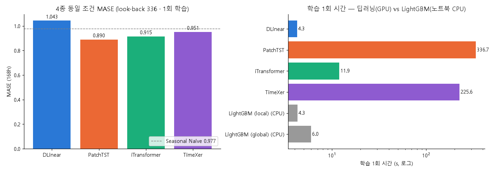
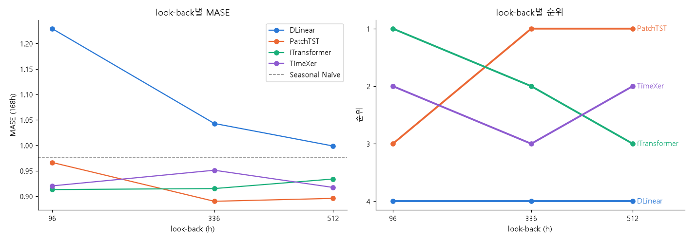
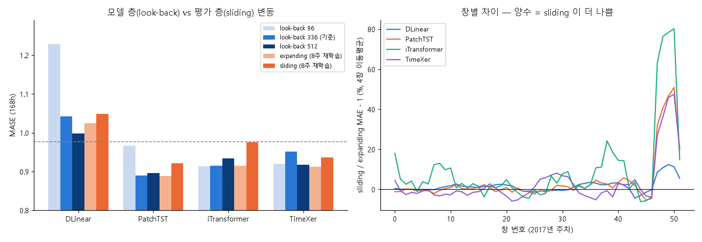
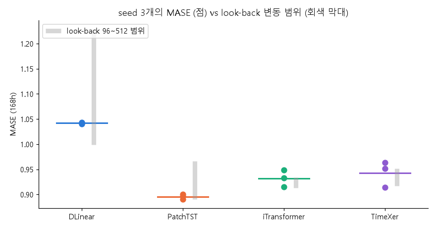
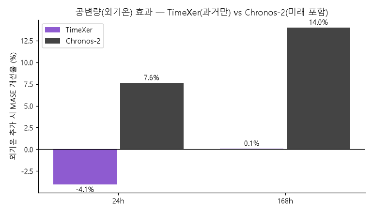
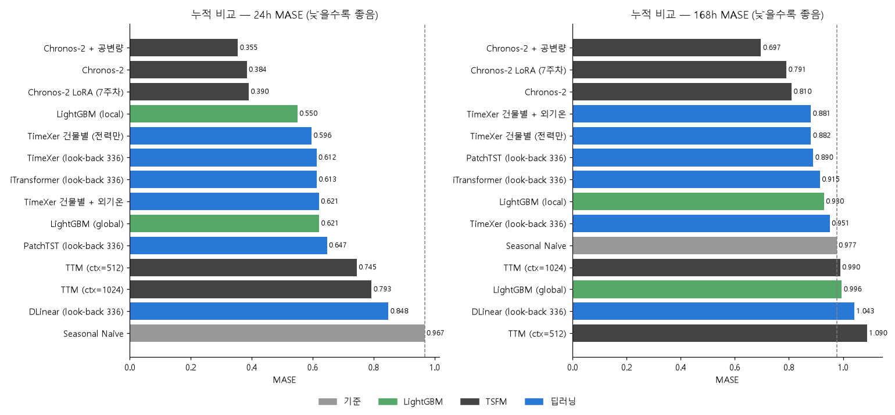

# 주간 보고서 — 8주차

## 1. 기본 정보
- 주차 / 기간: 8주차, 2026-11-03 ~ 2026-11-05
- 작성자: 김동호
- 실습시간: 계획 8h / 실제 13h

## 2. 이번 주 목표
1. Time-Series-Library로 딥러닝 예측 모델 4종(PatchTST, iTransformer, TimeXer, DLinear)을 동일 조건에서 비교
2. look-back 길이 민감도 측정, 논문 SOTA 재현성 확인
3. 24h LoRA 재조정 — 2016년 내부 검증으로 step, lr 선택

> **목표 3 변경(보류)**: 8주차 교재 범위(8-1~8-5) 밖이고, GPU 서버 시간을 8-3b 재학습 실험(약 2.5시간)에 우선 배정

## 3. 수행 내역

|   | 과제 | 산출물 |
|---|---|---|
| 1 | 8-1. TSLib 클론 + BDG2 어댑터 | `src/tslib_adapter.py`, `notebooks/wk08_Time-Series_Library.ipynb` (8-1 점검 셀) |
| 2 | 8-2. 4종 동일 조건 비교 | `results/wk8/same_condition_table.csv`, `same_condition.png` |
| 3 | 8-3a. look-back 민감도 | `results/wk8/lookback_mase.csv`, `lookback_rank.csv`, `lookback_sensitivity.png` |
| 4 | 8-3b. 하네스 설계 민감도 | `results/wk8/harness_rank.csv`, `sensitivity_comparison.csv`, `harness_sensitivity.png` |
| 5 | (추가) seed 편차 | `results/wk8/seed_variance.csv`, `seed_variance.png` |
| 6 | 8-4. TimeXer 외기온 공변량 | `results/wk8/timexer_covariate.csv`, `covariate_comparison.png` |
| 7 | 8-5. 하네스 통합, 누적 비교표 | `results/wk8/tidy/*.csv`, `cumulative_table.csv`, `cumulative_mase.png` |
| 8 | (추가) horizon별 순위, 채널 혼합 비교 | `results/wk8/horizon_rank.csv`, `channel_mixing.csv` |
| - | 원본 기록 | `results/wk8/preds/*.parquet` (36개 실행), `run_log.csv`, `fit_log.csv`, `smoke_timing.csv`, `env.json` |
| - | 분석 노트북 (CPU) | `notebooks/wk08_analysis.ipynb` |

**공통 실험 조건**
- 평가: 2주차 하네스 그대로 — 2017년 52창, step 168h, expanding, MASE(분모 = 첫 평가 시점 이전 계절 naive 168h)
- 데이터: 1주차 17개 건물 = 채널 17개(`M`). TSLib ECL 데이터셋(고객 321명 = 채널)과 같은 구조
- 하이퍼파라미터: TSLib `scripts/long_term_forecast/ECL_script/*.sh`의 구조 설정 그대로(튜닝 없음). batch 32, 에폭 상한 10, patience 3, Adam, MSE, lradj type1, seed 2021
- **학습 방식**: 교재 기준 "설정당 학습 1회" — 첫 평가 시점 이전 데이터(2016-01-01 ~ 2017-01-01, 8,808행)로 1회 학습 후 52창 예측. **8-3b만 8주마다 재학습**(아래 6절)
- 장비: NVIDIA GB10 (DGX Spark), torch 2.10.0+cu130, TSLib 커밋 `4e938a1`

## 4. 정량 결과

> 베이스라인 = 2주차 Seasonal Naive: 24h **0.9673** / 168h **0.9767**

### 4-1. BDG2 → TSLib 어댑터 (과제 8-1)

TSLib의 `run.py`는 데이터를 7:1:2로 고정 분할하고 정규화된 척도의 MSE로만 채점함 → 그대로는 2주차 하네스(52창, MASE)와 비교 불가. **모델 클래스만 TSLib에서 가져오고, 데이터·학습 루프는 하네스의 `model_fn`/`predict_fn`으로 감쌈.**

| 항목 | TSLib `run.py` | 어댑터 |
|---|---|---|
| 분할 | 전체 7:1:2 고정 | 하네스가 넘긴 학습 구간의 끝 10% = 검증(early stopping) |
| 정규화 | 학습 구간 | 학습 구간만 (검증·평가 구간 누설 없음) |
| 평가 | 테스트 구간 매 시점, 정규화 척도 | 52개 origin, 원 단위로 되돌려 MASE |
| 결측(302개) | 처리 없음 | 입력은 ffill, 손실은 관측 타깃만 |
| 외기온 | 파일 열 하나 | 건물별 `[사이트 외기온, 전력]` (8-4) |

| 점검 (GPU) | 결과 |
|---|---|
| 시간 특징이 TSLib `time_features(freq='h')`와 같은지 | 일치 |
| 4종 × look-back 3종 출력 형태 | 전부 `(2, 168, 17)`, TimeXer `MS`는 `(2, 168, 1)` |
| 2창 백테스트 | 5,712행 = 2창 × 168h × 17건물, NaN 0 |

### 4-2. 4종 동일 조건 비교 (과제 8-2) — look-back 336 · 168h · 1회 학습

| 모델 | MASE (168h) | Naive 대비 | 학습 1회 | DLinear 대비 | 실행 에폭 | 최대 VRAM | 파라미터 |
|---|---|---|---|---|---|---|---|
| **PatchTST** | **0.8901** | **−8.9%** | 336.7s | ×79 | 7 | 4.56GB | 9.93M |
| iTransformer | 0.9150 | −6.3% | 11.9s | ×2.8 | 4 | 0.23GB | 4.99M |
| TimeXer | 0.9510 | −2.6% | 225.6s | ×53 | 4 | 4.18GB | 14.70M |
| DLinear | 1.0429 | +6.8% | 4.3s | ×1 | 10 | 0.10GB | 0.11M |
| (참고) LightGBM local | 0.9298 | −4.8% | 4.3s (노트북 CPU) | | | | |

측정 조건: GPU 1장 단독 사용, batch 32, 학습 1회(8,808행), seed 2021

### 4-3. 모델 층 — look-back 민감도 (과제 8-3a) — 168h · 1회 학습

| look-back | 1위 | 2위 | 3위 | 4위 |
|---|---|---|---|---|
| 96 | **iTransformer** 0.913 | TimeXer 0.920 | PatchTST 0.966 | DLinear 1.229 |
| 336 | **PatchTST** 0.890 | iTransformer 0.915 | TimeXer 0.951 | DLinear 1.043 |
| 512 | **PatchTST** 0.896 | TimeXer 0.917 | iTransformer 0.934 | DLinear 0.999 |

**순위 역전: 있음** — look-back 96에서 1위가 PatchTST → iTransformer로 바뀜. 2, 3위(iTransformer ↔ TimeXer)는 매 설정마다 뒤바뀜

### 4-4. 평가 층 — 하네스 설계 민감도 (과제 8-3b) — look-back 336 · 168h · 8주마다 재학습

| 하네스 설계 | 1위 | 2위 | 3위 | 4위 | 1위의 MASE |
|---|---|---|---|---|---|
| 2주차 설계 (expanding) | PatchTST | TimeXer | iTransformer | DLinear | **0.8885** |
| 반대 설계 (sliding) | PatchTST | TimeXer | iTransformer | DLinear | **0.9207** |

| 모델 | expanding | sliding | 변화 |
|---|---|---|---|
| PatchTST | 0.8885 | 0.9207 | +3.6% |
| TimeXer | 0.9127 | 0.9358 | +2.5% |
| iTransformer | 0.9152 | 0.9761 | **+6.6%** |
| DLinear | 1.0250 | 1.0480 | +2.3% |

인자 적용 확인: 학습 행 수 expanding 8,808 → 16,872 (재학습마다 증가) / sliding 8,760 고정

**두 층(+ seed)의 변동 크기 비교**

| 손잡이 | 기준 | 순위 바뀐 모델 수 | 1위 바뀜 | Kendall τ | 평균 \|ΔMASE\| | 최대 \|ΔMASE\| |
|---|---|---|---|---|---|---|
| 모델 층: look-back 96 | look-back 336 | **3** | **예** | 0.33 | **7.5%** | 17.9% |
| 모델 층: look-back 512 | look-back 336 | 2 | 아니오 | 0.67 | 2.6% | 4.2% |
| **평가 층: sliding** | expanding | **0** | 아니오 | 1.00 | **3.8%** | 6.6% |
| 참고: seed 0 | seed 2021 | 2 | 아니오 | 0.67 | 1.8% | 3.9% |
| 참고: seed 1 | seed 2021 | 0 | 아니오 | 1.00 | 1.4% | 3.7% |

### 4-5. seed 편차 (추가) — look-back 336 · 168h · 1회 학습

| 모델 | seed 2021 | seed 0 | seed 1 | 표준편차 | look-back 96~512 범위 | \|sliding − expanding\| | sliding 차이 / seed 표준편차 |
|---|---|---|---|---|---|---|---|
| PatchTST | 0.8901 | 0.9004 | 0.8962 | 0.0052 | 0.0762 | 0.0322 | 6.2 |
| iTransformer | 0.9150 | 0.9323 | 0.9487 | 0.0169 | 0.0208 | 0.0609 | 3.6 |
| TimeXer | 0.9510 | 0.9140 | 0.9632 | **0.0256** | 0.0338 | 0.0231 | **0.9** |
| DLinear | 1.0429 | 1.0399 | 1.0427 | 0.0017 | 0.2306 | 0.0231 | 13.6 |

seed별 순위: PatchTST 1위·DLinear 4위는 3개 seed 모두 고정, **2·3위는 seed 0에서 뒤바뀜**

### 4-6. TimeXer 외기온 공변량 (과제 8-4) — 건물별 · look-back 336 · 1회 학습

| horizon | TimeXer 전력만 | TimeXer + 외기온 | TimeXer 개선율 | 개선 건물 | Wilcoxon p | Chronos-2 개선율 (5주차) |
|---|---|---|---|---|---|---|
| 24h | 0.5963 | 0.6205 | **−4.1%** | 4/17 | 0.109 | +7.6% |
| 168h | 0.8816 | 0.8811 | **+0.1%** | 10/17 | 0.963 | +14.0% |

⚠ TimeXer는 **과거** 외기온만, Chronos-2는 예측 구간의 **미래 외기온(실측)**까지 사용

### 4-7. 추가 관찰 — horizon별 순위 · 건물 혼합(M) vs 건물별(S)

| horizon (look-back 336) | 1위 | 2위 | 3위 | 4위 |
|---|---|---|---|---|
| 24h | **TimeXer** 0.612 | iTransformer 0.613 | PatchTST 0.647 | DLinear 0.848 |
| 168h | **PatchTST** 0.890 | iTransformer 0.915 | TimeXer 0.951 | DLinear 1.043 |

| TimeXer (look-back 336) | 24h | 168h |
|---|---|---|
| 17채널 한 입력 (M) | 0.6124 | 0.9510 |
| 건물별 (S) | **0.5963** | **0.8816** |
| 건물별 개선율 | 2.6% | **7.3%** |
| 건물별이 더 좋은 건물 | 10/17 | **16/17** |

### 4-8. 누적 비교표 (과제 8-5)

| 모델 | MASE 24h | Naive 대비 | MASE 168h | Naive 대비 | 학습 1회 | 장치 |
|---|---|---|---|---|---|---|
| Seasonal Naive | 0.9673 | 0% | 0.9767 | 0% | — | — |
| LightGBM (local) | 0.5501 | −43.1% | 0.9298 | −4.8% | 4.3s | 노트북 CPU |
| LightGBM (global) | 0.6211 | −35.8% | 0.9955 | +1.9% | 6.0s | 노트북 CPU |
| Chronos-2 | 0.3837 | −60.3% | 0.8100 | −17.1% | 학습 없음 | |
| **Chronos-2 + 공변량** | **0.3545** | **−63.3%** | **0.6969** | **−28.7%** | 학습 없음 | |
| Chronos-2 LoRA (7주차) | 0.3904 | −59.6% | 0.7908 | −19.0% | 268.9s | GPU |
| TTM (ctx=512) | 0.7447 | −23.0% | 1.0899 | +11.6% | 학습 없음 | |
| TTM (ctx=1024) | 0.7933 | −18.0% | 0.9898 | +1.3% | 학습 없음 | |
| DLinear | 0.8484 | −12.3% | 1.0429 | +6.8% | 4.3s | GPU |
| PatchTST | 0.6469 | −33.1% | 0.8901 | −8.9% | 336.7s | GPU |
| iTransformer | 0.6134 | −36.6% | 0.9150 | −6.3% | 11.9s | GPU |
| TimeXer | 0.6124 | −36.7% | 0.9510 | −2.6% | 225.6s | GPU |
| TimeXer 건물별 (전력만) | 0.5963 | −38.3% | 0.8816 | −9.7% | 471.7s | GPU |
| TimeXer 건물별 + 외기온 | 0.6205 | −35.8% | 0.8811 | −9.8% | 532.4s | GPU |

딥러닝은 look-back 336 · 1회 학습. 학습 시간은 168h 실행 값. 예측값은 2주차 하네스 tidy 형식으로 `results/wk8/tidy/`에 저장

## 5. 해석

**8-1.**
- 어댑터 작업의 핵심은 형식 변환이 아니라 **TSLib의 평가 방식(7:1:2 고정 분할, 정규화 척도 MSE)을 버리고 2주차 하네스에 맞추는 것**이었음. 그대로 `run.py`를 썼다면 8-5(LightGBM, Chronos-2와 같은 표)가 불가능
- 하네스 코드를 고치지 않고 `train_mode` 인자만으로 8-3b를 돌릴 수 있었던 것도 `model_fn`/`predict_fn` 형식으로 감쌌기 때문

결과: TSLib 4종이 1~7주차 모델과 같은 지표·같은 52창으로 비교됨

**8-2.**
- PatchTST가 0.890으로 4종 중 1위, Naive 대비 8.9% 개선. 단 학습 시간은 DLinear의 79배(337초), VRAM 4.6GB
- iTransformer는 2위(0.915)인데 학습 11.9초 — 성능 차이 2.8%에 학습 시간은 1/28. 건물 17개가 토큰 17개라 계산이 가벼움
- PatchTST·TimeXer·iTransformer는 best 에폭이 1~4로 빨리 과적합한 반면, DLinear는 10에폭 내내 검증 손실이 줄어 **에폭 상한에서 수렴 전**

결과: 판정 기준 "학습 시간이 LightGBM의 수십~수백 배"와 일치 (PatchTST 336.7s vs LightGBM 4.3s, 78배)

**8-3a.**
- look-back 96 → 336에서 **1위가 바뀜** (iTransformer 0.913 → PatchTST 0.890). 이 차이(0.053)는 seed 표준편차(0.005~0.017)보다 훨씬 커서 **진짜 역전**
- 반면 iTransformer ↔ TimeXer의 2·3위 교체(차이 0.002~0.036)는 **seed만 바꿔도 생기는 크기** (4-5: seed 0에서 같은 교체 발생, TimeXer seed 표준편차 0.026) → 노이즈 범위
- DLinear는 look-back에 가장 민감 (1.229 → 0.999, 18.8% 개선). 선형층 하나라 입력 길이가 곧 표현력

결과: "A가 B보다 좋다"는 주장은 look-back 설정과 seed에 따라 뒤집힐 수 있음. 1위 교체만이 노이즈를 넘는 역전

**8-3b.**
- sliding으로 바꿔도 **순위는 그대로**(Kendall τ = 1.0). 교재가 예상한 "평가 층 변동 > 모델 층 변동"은 **순위 기준으로는 성립하지 않음**
- 그러나 **점수는 4종 모두 같은 방향으로 나빠짐**(+2.3~6.6%, 평균 3.8%) — look-back 512로 바꿨을 때(2.6%)보다 큼. 모델과 무관한 체계적 이동
- **기준선 대비 결론은 바뀜**: iTransformer는 expanding에서 Naive보다 6.3% 좋지만 sliding에서는 0.976으로 **Naive(0.977)와 같아짐**. "이 모델이 베이스라인을 이긴다"는 결론이 하네스 인자 하나로 사라짐
- 창별로 보면 sliding의 손해는 **2017년 마지막 5주(12월)에 몰려 있음** (창 47~51에서 +10~80%). 원인 미검증 — 후보: 마지막 재학습(2017-12-04)의 검증 구간(2017년 11월)에 Bull_office_Ella 급증이 들어 있어, 학습 데이터가 1년뿐인 sliding 쪽의 정규화 통계·early stopping이 더 크게 흔들렸을 가능성
- seed 대비: PatchTST·iTransformer·DLinear의 sliding 손해는 seed 표준편차의 3.6~13.6배 → 실제 효과. TimeXer(0.9배)는 노이즈 범위
- 2주차에 "데이터가 2년뿐이라 sliding은 역사를 너무 많이 버린다"며 expanding을 고른 판단이 딥러닝에서도 실측으로 뒷받침됨

결과: 평가 설계는 **순위는 못 흔들었지만 절대 점수와 "베이스라인을 이기는가"는 흔듦**

**8-4.**
- TimeXer는 외기온으로 이득이 없음 (24h −4.1%, 168h +0.1%, 둘 다 Wilcoxon p > 0.1 → 유의한 차이 없음)
- Chronos-2(+7.6% / +14.0%)와의 차이는 모델 성능이 아니라 **구조 차이**로 해석: 냉난방 부하에 필요한 건 "예측 구간의 기온"인데 TimeXer는 과거 기온만 봄. 과거 기온 정보는 과거 전력 패턴에 이미 반영돼 추가 정보가 적음
- 실무 함의: 외기온 공변량의 가치는 **기상 예보(미래 값)를 넣을 수 있는 모델**에서만 나옴

결과: 공변량 개선폭 비교는 "미래 공변량 사용 가능 여부"를 같이 적어야 공정함

**추가 관찰.**
- horizon을 바꿔도 순위가 바뀜: 168h 1위 PatchTST가 24h에서는 3위. 순위를 흔드는 손잡이가 look-back·seed·horizon 셋
- 같은 TimeXer라도 건물 17개를 한 입력에 섞으면(M) 168h 0.951, 건물별로 따로 보면(S) 0.882 — **16/17 건물에서 건물별이 더 좋음**. 사이트·용도가 다른 건물끼리 서로 참고하면 오히려 방해. TimeXer 건물별(0.8816)은 168h 딥러닝 전체 1위

**8-5.**
- 168h: 딥러닝 최고(TimeXer 건물별 0.882, PatchTST 0.890)가 LightGBM local(0.930)보다 4~5% 좋음. 그러나 학습 없는 Chronos-2 zero-shot(0.810)보다 9~10% 나쁘고, Chronos-2 + 공변량(0.697)과는 큰 차이
- 24h: 딥러닝 최고(TimeXer 건물별 0.596)가 LightGBM local(0.550)보다 8.4% 나쁨 → 판정 기준 "딥러닝 4종이 LightGBM에 모두 짐 → 정상"
- DLinear는 168h에서 Naive보다 나쁨(+6.8%)

결과: 성능·비용 모두에서 **딥러닝 예측 전용 모델이 Chronos-2 zero-shot을 대체할 근거 없음**. LightGBM 대비 우위는 168h에서만, 학습 시간 50~80배 비용

## <자가점검 리스트>

**자가 점검 1. DLinear가 몇 등이었는가? 예상과 달랐는가?**
- **모든 조건에서 4위** (look-back 3종, horizon 2종, seed 3개, 하네스 2종). 교재의 "DLinear 상위권이 흔함"과 다름
- 원인 후보: ① TSLib DLinear에는 입력 정규화(RevIN)가 없어 2017년 11월 Bull_office_Ella 급증(직전 1년 평균 대비 z ≈ 109) 같은 수준 변화에 약함 ② 10에폭 내내 검증 손실이 줄어 수렴 전 (교재 조건으로 에폭 상한을 늘리지 않음). 둘 다 미검증

**자가 점검 2. look-back에 따라 순위가 바뀌었는가? 논문의 "SOTA" 주장은 무엇을 의미하는가?**
- 바뀜. look-back 96에서는 iTransformer, 336·512에서는 PatchTST가 1위
- 논문의 "SOTA"는 **특정 look-back·horizon·seed·평가 분할에서의 1위**일 뿐. 이번 실험에서 2·3위 교체는 seed 하나로도 재현됨 → seed 반복 없는 순위 비교는 신뢰하기 어려움

**자가 점검 2-1. 하네스 설계를 바꿨을 때의 변동은 look-back을 바꿨을 때보다 컸는가, 작았는가?**
- **순위는 더 작음** (0개 vs 2~3개). **절대 점수는 중간** (평균 3.8% — look-back 512의 2.6%보다 크고 96의 7.5%보다 작음). 단 4종 모두 같은 방향이라 "베이스라인을 이기는가" 결론을 바꿈(iTransformer)
- 2주차 결정의 신중함: expanding을 "데이터가 2년뿐이라 역사를 버리지 않으려고" 선택했고, 이번 결과가 그 근거를 실측으로 확인함. 다만 당시에는 sliding을 실제로 돌려 보지 않고 추론으로만 정했음

**자가 점검 3. 4종 중 가장 좋은 모델이 LightGBM을 이겼는가? 학습 시간과 GPU 요구를 감안하면 어떤가?**
- 168h: 이김 (PatchTST 0.890 vs LightGBM local 0.930, 4.3% 개선). 24h: 짐 (0.612 vs 0.550, 11.3% 악화)
- 비용: PatchTST 학습 337초·GPU VRAM 4.6GB vs LightGBM 4.3초·노트북 CPU → 78배 시간에 GPU 필요. 168h에서 4% 개선을 위해 지불할 비용으로는 과함. 같은 GPU 비용이면 Chronos-2 zero-shot(학습 없음, 0.810)이 더 좋음

**자가 점검 4. 회사에서 "이 논문 모델 도입합시다"라는 제안을 받으면, 무엇을 먼저 물어보겠는가?**
1. 어떤 look-back·horizon에서 측정했는가? 우리 운영 설정에서도 같은 순위인가?
2. seed 몇 개로 반복했고, 편차는 얼마인가? (이번 주 TimeXer는 seed 편차가 look-back 효과보다 컸음)
3. 평가 분할은 무엇인가? (고정 7:1:2인가, 롤링 백테스트인가 / expanding인가 sliding인가)
4. DLinear·Seasonal Naive·LightGBM 같은 단순 베이스라인과 비교했는가?
5. 학습 시간·GPU 요구는? 사전학습 모델 대비 이득이 그 비용을 정당화하는가?

## 6. 막힌 점

| 문제 | 가설 | 검증 방법 | 결과 |
|---|---|---|---|
| 창마다 재학습하면 실험이 끝나지 않음 | 트랜스포머 학습 1회가 길어서 | look-back 512 · 최장 구간으로 학습 1회 측정: PatchTST 465s, TimeXer 531s → 24개 실행 × 13회 재학습 상한 약 27시간 | 교재 기준 "설정당 학습 1회"로 변경. 단 1회 학습이면 expanding(8,808행)과 sliding(8,760행)의 학습 데이터가 거의 같아 8-3b가 성립하지 않음 → **8-3b만 8주마다 재학습**(7회). 총 약 4시간으로 단축 |

## 7. 다음 주 목표
1. TSB-AD 평가 모듈을 연동하고 LEAD 1.0을 TSB-AD 형식으로 변환한다.
2. 무작위 예측기(p = 0.5% / 1% / 5%)의 point-adjust F1과 VUS-PR 표를 만든다.
3. 6종 기법(CATCH, DADA, Sub-LOF, Matrix Profile, IsolationForest, LightGBM 잔차)을 LEAD 1.0에 적용해 두 지표로 비교하고, 순위 차이를 명시한다.