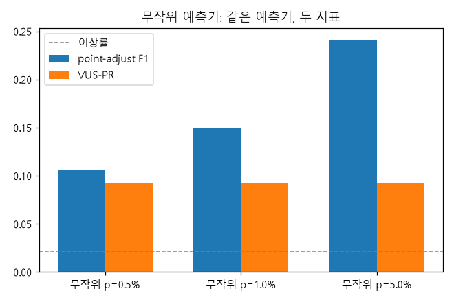
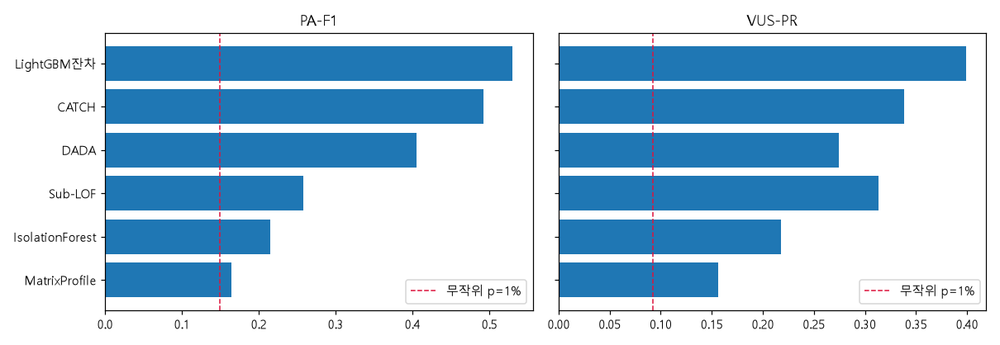
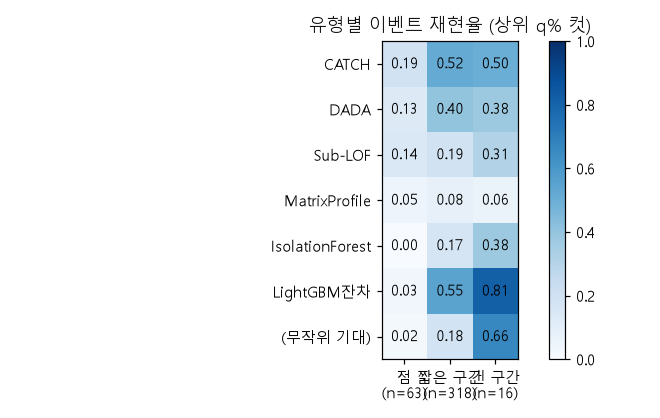
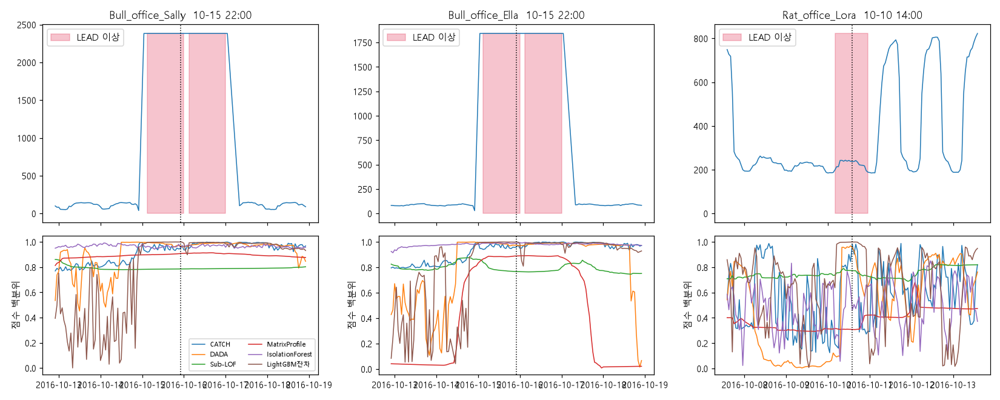

# 주간 보고서 — 9주차

## 1. 기본 정보
- 주차 / 기간: 9주차, 2026-11-05 ~ 2026-11-06 
- 작성자: 김동호
- 실습시간: 계획 8h / 실제 9h

## 2. 이번 주 목표
1. TSB-AD 평가 모듈을 연동하고 LEAD 1.0을 TSB-AD 형식으로 변환한다.
2. 무작위 예측기(p = 0.5% / 1% / 5%)의 point-adjust F1과 VUS-PR 표를 만든다.
3. 6종 기법(CATCH, DADA, Sub-LOF, Matrix Profile, IsolationForest, LightGBM 잔차)을 LEAD 1.0에 적용해 두 지표로 비교하고, 순위 차이를 명시한다.

> **변경, 추가**
> - **CATCH 적용 방식 변경**: 건물별 단변량 → 17개 건물을 17채널로 한 모델에 학습
> - 2주차 하네스(52창, MASE)는 쓰지 않음. 이상진단은 LEAD 2016년 1년치 · 건물별 VUS-PR / PA-F1로 평가하며, **8주차까지의 MASE 표와 점수를 나란히 비교할 수 없음.**

## 3. 수행 내역

|   | 과제 | 산출물 |
|---|---|---|
| 1 | 9-1. TSB-AD 평가 연동 · LEAD → TSB-AD 형식 | `src/anomaly_adapter.py`, `results/wk9/tsb_format/*.csv`(17개), `profile.csv` |
| 2 | 점수 생성 (6종 × 17건물) | `notebooks/wk09_anomaly_models.ipynb`, `results/wk9/scores/*.parquet`, `run_log.csv`, `failures.csv`, `env.json` |
| 3 | 9-2. point-adjust 함정 재현 | `random_predictor.csv`, `random_predictor.png`, `random_predictor_detail.csv` |
| 4 | (추가) 부풀림 원인 확인 | `pa_inflation_by_length.csv`, `random_vus_window.csv` |
| 5 | 9-3. 6종 비교 | `method_comparison.csv`, `method_comparison.png`, `per_building_metrics.csv`, `vuspr_spread.csv`, `cumulative_row.csv` |
| 6 | 9-4. 이상 유형별 분석 | `type_recall.csv`, `type_recall.png` |
| 7 | 9-5. 이상 근거 3건 | `explain_events.csv`, `explain_events.png` |
| 8 | (추가) 결과 점검 3종 | `check_matrixprofile.csv`, `check_label_flat.csv`, `check_random_oracle.csv` |
| - | 분석 노트북 (CPU) | `notebooks/wk09_analysis.ipynb` |

**공통 조건**
- 데이터: 1주차 17개 건물 × 2016년 8,784h (LEAD 라벨 기간). 라벨 매칭 17/17, 이상률 2.15%, 이상 구간 397개 (중앙 7h · 평균 8.1h · 최장 72h)
- 건물마다 따로 평가 후 평균. `slidingWindow`는 TSB-AD 자동 주기 탐지 값 (건물별 24 / 125 / 140 / 168 / 241h), Sub-LOF · Matrix Profile · IsolationForest 창과 VUS 허용 오차에 같은 값 사용
- PA-F1은 TSB-AD 관례대로 **최적 임계값(oracle)**. 무작위 예측기만 고정 p

## 4. 정량 결과

> 이상진단의 기준선 = **무작위 예측기(p = 1%)**: PA-F1 0.1489 / VUS-PR 0.0926. (2주차 Seasonal Naive는 예측용이라 해당 없음)

### 4-1. 과제 9-2 — 무작위 예측기: PA-F1 vs VUS-PR 

| 예측기 | point-adjust F1 | 일반 F1 | **부풀림 (PA-F1 ÷ F1)** | VUS-PR | VUS-PR ÷ 이상률(2.15%) |
|---|---|---|---|---|---|
| 무작위 p=0.5% | 0.1061 | 0.0091 | 11.7배 | 0.0923 | 4.3 |
| 무작위 p=1% | 0.1489 | 0.0118 | 12.6배 | 0.0926 | 4.3 |
| 무작위 p=5% | 0.2411 | 0.0295 | 8.2배 | 0.0919 | 4.3 |
| 무작위 **(최적 임계값)** | **0.2965** | — | — | 0.092 | 4.3 |

건물 17개 × seed 5개 평균. **교재가 예고한 "PA-F1 > 0.7"은 나오지 않음**. 마지막 줄은 무작위 점수에 6종과 **같은 조건(최적 임계값)** 을 준 PA-F1로, 6종 PA-F1과 공정하게 비교하는 기준선.

**이상 구간 길이만 바꾼 합성 라벨 (이상률 ≈ 2.15%, 무작위 p=1%, 30회 평균)**

| 구간 길이 | 1h | 7h (실제 중앙값) | 24h | 100h (교재 예시) | 300h |
|---|---|---|---|---|---|
| PA-F1 | 0.014 | 0.082 | 0.231 | **0.624** | **0.820** |
| 부풀림 (÷ F1) | 1.0배 | 6.6배 | 17.4배 | 40.6배 | 58.3배 |

### 4-2. 과제 9-3 — 6종 비교

| 기법 | 계열 | PA-F1 | VUS-PR | PA-F1 순위 | VUS-PR 순위 | 순위 차이 | VUS-PR ÷ 무작위(1%) | 건물별 1위 | 17건물 합계 시간 | GPU |
|---|---|---|---|---|---|---|---|---|---|---|
| LightGBM 잔차 (지도) | 4주차 | 0.5299 | **0.3990** | 1 | 1 | 0 | 4.31배 | 3 | (4주차) | 불필요 |
| **CATCH** | 딥러닝 | 0.4925 | 0.3383 | 2 | 2 | 0 | 3.65배 | 4 | 72.8s (학습, 17채널 1모델) | 학습 필요 |
| Sub-LOF | 고전 | 0.2576 | 0.3132 | 4 | **3** | +1 | 3.38배 | 3 | 4.3s | 불필요 |
| DADA | 사전학습 | 0.4057 | 0.2741 | **3** | 4 | −1 | 2.96배 | 3 | 0.5s (추론, 학습 없음) | 추론 필요 |
| IsolationForest | 고전 | 0.2154 | 0.2179 | 5 | 5 | 0 | 2.35배 | 3 | 1.5s | 불필요 |
| Matrix Profile | 고전 | 0.1645 | 0.1564 | 6 | 6 | 0 | 1.69배 | 1 | 49.3s | 불필요 |

- 두 지표 순위의 Kendall τ = **0.87**. 순위가 갈린 것은 DADA ↔ Sub-LOF 한 쌍뿐
- 참고 — 무작위 p=1%: PA-F1 0.149 / VUS-PR 0.093, p=5%: PA-F1 0.241

**점검 ① — Matrix Profile 설정 변형 (VUS-PR 평가 창은 모두 기존 값으로 고정)**

| 설정 | PA-F1 | VUS-PR | 무작위(1%) 대비 |
|---|---|---|---|
| z-정규화 · 창 건물별 (**TSB-AD 기본 = 위 표의 값**) | 0.1645 | 0.1564 | 1.69배 |
| z-정규화 · 창 24 | 0.2102 | 0.1684 | 1.82배 |
| z-정규화 · 창 168 | 0.1913 | 0.1822 | 1.97배 |
| 원값 거리 · 창 24 | 0.3515 | **0.3931** | **4.25배** |
| 원값 거리 · 창 168 | 0.2456 | 0.2533 | 2.74배 |

**건물 간 편차 (VUS-PR)**

| 기법 | 평균 | 중앙값 | 건물간 표준편차 | CATCH와 차이 (Wilcoxon p) |
|---|---|---|---|---|
| LightGBM 잔차 | 0.399 | 0.406 | 0.284 | 0.35 |
| CATCH | 0.338 | 0.264 | 0.267 | — |
| Sub-LOF | 0.313 | 0.342 | 0.187 | **0.93** |
| DADA | 0.274 | 0.168 | 0.292 | 0.057 |
| IsolationForest | 0.218 | 0.108 | 0.254 | 0.011 |
| Matrix Profile | 0.156 | 0.106 | 0.126 | 0.001 |

### 4-3. 과제 9-4 — 이상 유형별 이벤트 재현율

유형 = 구간 길이: 점 1h(63개) / 짧은 구간 2~24h(318개) / 긴 구간 24h 초과(**16개**). 건물의 실제 이상 개수만큼 상위 점수 컷에서 한 점이라도 걸리면 탐지

| 기법 | 점 (n=63) | 짧은 구간 (n=318) | 긴 구간 (n=16) |
|---|---|---|---|
| LightGBM 잔차 (지도) | 0.032 | **0.550** | **0.812** |
| CATCH | **0.190** | 0.516 | 0.500 |
| DADA | 0.127 | 0.399 | 0.375 |
| Sub-LOF | 0.143 | 0.189 | 0.312 |
| IsolationForest | 0.000 | 0.167 | 0.375 |
| Matrix Profile | 0.048 | 0.082 | 0.062 |
| (무작위 기대) | 0.016 | 0.184 | 0.665 |

### 4-4. 과제 9-5 — 이상 근거 3건 (4주차 SHAP과 같은 건)

| 건물 / 시각 | 실제값 | 같은 요일·시각 정상 중앙값 | 배수 | Matrix Profile 최근접 거리 | CATCH | DADA | Sub-LOF | MatrixProfile | IsolationForest | LightGBM 잔차 |
|---|---|---|---|---|---|---|---|---|---|---|
| Bull_office_Sally 10-15 22:00 | 2,383 | 69.0 | **34.5배** | 10.05 | 0.948 | 0.971 | 0.786 | 0.908 | 0.958 | 1.0 |
| Bull_office_Ella 10-15 22:00 | 1,842 | 76.7 | **24.0배** | 8.82 | 0.959 | 0.975 | 0.767 | 0.890 | 0.988 | 1.0 |
| Rat_office_Lora 10-10 14:00 | 237.7 | 741.9 | **0.32배** | 2.19 | 0.983 | 0.956 | 0.774 | **0.308** | **0.461** | 1.0 |

기법 열 = 그 시점 점수의 건물 내 백분위 (1.0 = 가장 이상).

## 5. 해석

**9-1.**
- TSB-AD 평가 모듈이 정상 동작함: 라벨을 그대로 점수로 주면 VUS-PR 1.000 (`Rat_office_Randy`)
- 17개 건물이 모두 LEAD와 매칭되고 이상이 1건 이상이라 평가에서 빠지는 건물이 없음

결과: 2016년 17건물 × 6기법 점수가 같은 형식(8,784 × 17)으로 저장됨

**9-2.**
- 무작위 예측기의 PA-F1은 0.11~0.24로 **교재의 0.7 기준에 못 미침**. 그러나 부풀림은 분명히 있음: 같은 예측기가 일반 F1은 0.009~0.030인데 PA-F1은 8~13배 (4-1 표)
- 원인은 **구간 길이**. 길이 L 구간이 한 번도 안 찍힐 확률은 (1−p)^L이라 평균 길이 8.1h인 실제 LEAD에서는 p=1%일 때 구간이 맞혀질 확률이 7.5%뿐. 구간 길이만 키운 합성 실험에서 PA-F1이 0.014(1h) → 0.082(7h) → **0.624(100h) → 0.820(300h)** 로 오름. 교재의 "0.9 넘김"은 긴 이상 구간 데이터에서 나오는 현상이고, 이 코드·데이터가 틀린 것이 아님
- VUS-PR은 p와 무관하게 0.092 안팎으로 일정. 즉 PA-F1은 p가 커질수록 올라가고(0.106 → 0.241) VUS-PR은 안 올라감. 지표가 예측기의 "찍는 개수"를 보상하는지가 두 지표의 차이
- 무작위 VUS-PR(0.092)이 이상률(0.0215)의 4.3배인 이유는 **허용 오차 창**: 창을 1로 줄이면 이상률 수준으로 내려옴 (`Rat_office_Randy`: 이상률 0.065, 창 1에서 0.069, 실제 창 168에서 0.206). 따라서 VUS-PR 값은 항상 무작위 기준선(0.093)과 함께 읽어야 함

결과: 무작위 예측기의 PA-F1 부풀림은 재현됨(8~13배). 절대값 0.7은 이 데이터의 짧은 이상 구간 때문에 재현되지 않으며, 같은 예측기가 구간 길이 100~300h에서는 0.62~0.82

**9-3.**
- 두 지표 순위는 대체로 같음 (τ = 0.87). **갈린 것은 DADA(PA-F1 3위, VUS-PR 4위)와 Sub-LOF(4위 → 3위)** 한 쌍. PA-F1은 DADA를 0.406으로 후하게, Sub-LOF를 0.258로 박하게 봄. 교재가 기대한 "순위가 크게 다름"은 이번 데이터에서는 약하게만 나옴
- 같은 조건(최적 임계값)의 **무작위 점수 PA-F1은 0.2965**. **Sub-LOF(0.258) · IsolationForest(0.215) · Matrix Profile(0.165) 3종이 이보다 낮음**. PA-F1만 보면 무작위 점수보다 못하지만 VUS-PR로는 무작위의 3.38 / 2.35 / 1.69배. 두 지표가 같은 기법을 정반대로 읽는 사례
- **Matrix Profile 최하위는 설정 영향이 큼**: 기본 설정은 z-정규화(모양만 비교, 크기 무시)라 창을 24나 168로 바꿔도 VUS-PR이 0.16~0.18에 머묾. 원값 거리로 바꾸고 창 24를 쓰면 **0.393**으로 CATCH(0.338)·Sub-LOF(0.313)보다 높고 PA-F1은 0.352. 건물 에너지 이상은 "모양"보다 "크기"가 벗어나는 경우가 많아서일 수 있음. 단 5개 설정 중 라벨을 보고 고른 값이라 최종 순위에는 반영하지 않고 참고로만 둠
- **CATCH(딥러닝)가 Sub-LOF(고전)를 이겼다고 말할 수 없음**: 평균 0.338 vs 0.313이지만 건물 간 표준편차가 0.19~0.27로 더 크고 Wilcoxon p = 0.93. IsolationForest(p=0.011), Matrix Profile(p=0.001)보다는 유의하게 좋고 DADA와는 경계(p=0.057). 건물별 1위도 CATCH 4 / DADA·Sub-LOF·IForest·LightGBM 각 3 / MP 1로 갈림. 교재의 "고전이 최신 딥러닝을 이김"은 Sub-LOF에 한해 **동률**
- LightGBM 잔차가 1위(0.399)이지만 **라벨로 정상 구간을 골라 학습하고 같은 해를 채점한 지도 방식**이라 비지도 5종과 공정한 비교가 아님. 비지도 중 1위는 CATCH
- 비용: Sub-LOF는 서버 CPU에서 17건물 4.3초로 CATCH(GPU, 73초)의 약 1/17 시간에 VUS-PR 0.313 vs 0.338. DADA는 학습 없이 0.5초

결과: 비지도 기준(TSB-AD 기본 설정) CATCH ≈ Sub-LOF > DADA > IForest > Matrix Profile. 모든 기법이 무작위의 1.7~4.3배(VUS-PR)로 의미 있지만 CATCH와 Sub-LOF는 구분되지 않음. Matrix Profile은 설정을 바꾸면 최상위권(사후 선택)이라 "고전이 약하다"로 읽으면 안 됨. CATCH만 건물 17개를 한 모델로 학습해 건물 간 정보를 공유하고, seed 한 개라 변동성은 미측정

**9-4.**
- **점 이상은 모두 어려움**: 최고 CATCH 0.190이 무작위 기대(0.016)의 약 12배지만 절대값은 낮고, LightGBM 잔차는 0.032, IsolationForest는 0.000
- **짧은 구간(318개, 대부분)**: LightGBM 잔차(0.550)·CATCH(0.516)가 무작위 기대(0.184)의 약 3배. **Sub-LOF(0.189)·IsolationForest(0.167)는 무작위 수준**, Matrix Profile(0.082)은 무작위보다 낮음
- **긴 구간은 16개뿐이라 해석에 주의**: LightGBM 잔차(0.812)만 무작위 기대(0.665)를 넘고 나머지는 모두 아래. 긴 구간은 무작위로 찍어도 맞힐 확률이 높아 기준선 자체가 높고, 점수가 구간 안에 몰리는 기법은 같은 개수의 후보로 적은 구간만 덮는 한계도 있음
- Sub-LOF·IForest는 이 지표에서는 무작위 수준인데 VUS-PR은 무작위의 2.4~3.4배. 허용 오차가 이상 주변 점수에 점수를 주기 때문일 수 있으나 **미검증**

결과: "최신 모델이 특정 유형에서만 우세"는 부분적으로만 확인됨. CATCH는 점·짧은 구간에서 비지도 중 최고, 긴 구간 우위는 표본(16개)이 부족해 판단 보류

**9-5.**
- **Sally·Ella (10-15 22:00)**: 실제값이 같은 요일·시각 정상 대비 **34.5배·24.0배**이고 그림에서 이틀 가까이 거의 일정한 값에 머묾. 같은 시각·같은 `Bull` 사이트라 개별 건물보다 계측·공용 설비 이벤트 가능성(4주차와 같은 판단). CATCH 0.95 · DADA 0.97 · IForest 0.96~0.99 · Matrix Profile 0.89~0.91이 모두 상위 5~11%로 판정. 반면 Sub-LOF는 0.77~0.79로 가장 약함
- **Lora (10-10 14:00)**: 정상의 **0.32배로 급감**, 낮은 값 자체는 평소 밤에도 나오는 값. **CATCH(0.98)·DADA(0.96)는 상위로 잡았지만 Matrix Profile(0.31)·IsolationForest(0.46)는 못 잡음.** 값의 크기나 서브시퀀스 모양만 보면 정상 범위인 "낮은 값"이 "낮아야 할 시간이 아닌데 낮은" 문제라서 일 수 있음 (추정, 미검증). Matrix Profile은 점검 ①에서 z-정규화가 크기를 무시하는 것이 약점으로 확인됨
- Matrix Profile은 Ella에서 그림상 이틀 가까이 이어진 고원의 중간에서 점수가 평소 수준으로 떨어짐. 고원 구간끼리 서로 닮아 최근접 거리가 작아지는 **자기 매칭**이나 z-정규화의 영향으로 보이나, 개별 이벤트 수준의 확인은 안 함 (점검 ①은 전체 평균에서만 확인)
- **LightGBM 잔차 백분위 1.0은 선택 편향**: 이 3건은 4주차에서 LightGBM 잔차가 가장 큰 순서로 고른 이벤트

**SHAP(4주차)과 비교 — 현장에서 어느 쪽이 더 유용한가**

| 관점 | SHAP (4주차) | 이번 기법 (점수 백분위 + 대조 숫자) |
|---|---|---|
| 답하는 질문 | 예측이 왜 그 값이었나 (예: Sally 예측 93 = `lag_24` −79 등) → 실제와 괴리 | 평소, 다른 구간과 얼마나 다른가 |
| 현장 행동 | "최근 패턴으로 설명 안 되는 급증 → 계측·설비 점검" 처럼 방향이 나옴 | 점수 백분위만으로는 "이상하다"까지. **"정상 대비 34.5배"** 같은 대조 숫자가 있어야 행동이 나옴 |
| 라벨/학습 | 라벨로 정상 구간을 골라 학습한 모델 필요 | 라벨 없이 가능 (LightGBM 잔차 제외) |
| 한계 | 지도 방식 · 원인이 아니라 예측 기여 분해 | 기법이 왜 이상인지 말해 주지 않음 (점수 + 모양) |

- 이번 3건에서 행동으로 이어진 근거는 신규 기법의 점수가 아니라 **"같은 요일·시각 정상 대비 배수"라는 단순 대조값**. 신규 기법은 후보를 올리는 역할, 설명은 SHAP이나 대조값이 맡는 구성이 현장에서 더 유용하다는 것이 이번 주의 잠정 결론 (3건 · 한 사람의 판단)

결과: 3건 모두 비지도 기법 2종 이상이 상위 11% 안에 판정. 설명은 SHAP 쪽이 더 행동 가능하고, 라벨이 없는 상황에서는 대조값 + 점수 백분위 조합이 현실적

## 점검 — 결과가 믿을 만한가

| 점검 | 확인한 것 | 결과 |
|---|---|---|
| ① Matrix Profile 최하위 | 창 길이·z-정규화 여부 5개 설정 | 기본 설정은 창과 무관하게 0.16~0.18, **원값 거리 + 창 24에서 0.393**. 구현 오류가 아니라 z-정규화(모양만 비교) 설정의 영향. 사후 선택이라 순위에는 미반영 |
| ② 라벨 품질 | 12h 이상 같은 값이 이어진 구간과 라벨 겹침 | 고정값 528시점 중 **55%(291시점)가 라벨**. Sally·Ella는 고정값 구간의 **90%(110/122)** 를 라벨이 덮음 → 라벨이 고정 구간을 놓친다는 의심은 대체로 해소. 반대로 `Hog_parking_Antoinette`(119)·`Rat_office_Craig`(50)는 고정값인데 라벨 0 → 고정값이 곧 이상은 아님. 입력은 보간된 데이터라 보간 효과가 섞였을 수 있음 |
| ③ 무작위도 최적 임계값 | 6종과 같은 조건의 무작위 PA-F1 | **0.2965**. 6종 중 3종(Sub-LOF · IForest · Matrix Profile)이 이보다 낮음 |

## <자가점검 리스트>

**1. 무작위 예측기의 point-adjust F1은 얼마였는가? 이 숫자를 보고 무엇을 느꼈는가?**
- 0.106 / 0.149 / 0.241 (p = 0.5 / 1 / 5%). 0.7 이상을 예상했는데 낮아서 처음에는 코드가 틀렸는지 의심함
- 일반 F1은 0.009~0.030이라 **PA-F1은 8~13배 부풀림**이었고, 구간 길이를 100~300h로 키우면 같은 예측기가 0.62~0.82까지 오름. 지표의 부풀림은 데이터의 이상 구간 길이에 좌우됨. 논문의 PA-F1 숫자를 볼 때 이상 구간이 얼마나 긴 데이터인지부터 확인해야 한다고 느낌

**2. 최신 딥러닝 모델이 고전 기법을 이겼는가? 어느 지표로 봤을 때인가?**
- CATCH가 Sub-LOF를 두 지표에서 모두 앞섰으나(PA-F1 0.49 vs 0.26, VUS-PR 0.338 vs 0.313) **VUS-PR 차이는 통계적으로 구분되지 않음 (p = 0.93)**. IForest·Matrix Profile보다는 유의하게 좋음. DADA(zero-shot)는 Sub-LOF보다 VUS-PR이 낮음 (0.274 vs 0.313)
- PA-F1로만 보면 CATCH가 Sub-LOF를 2배 가까이 앞서는 것처럼 보임

**3. 두 지표에서 순위가 다르다면, 논문에서 point-adjust F1만 보고한 모델을 어떻게 봐야 하는가?**
- DADA ↔ Sub-LOF처럼 PA-F1이 순위를 뒤집을 수 있고, Sub-LOF·IForest·Matrix Profile 3종은 PA-F1(0.16~0.26)이 같은 조건의 무작위 점수(0.297)보다 낮은데 VUS-PR은 무작위의 1.7~3.4배였음. PA-F1만 보고한 숫자는 (1) 무작위 기준선, (2) VUS-PR, (3) 데이터의 이상 구간 길이가 같이 없으면 순위도 절대값도 믿기 어려움

**4. 현장에 배포한다면 어느 기법을 고르겠는가? 정확도 외에 무엇을 고려했는가?**
- 1차 후보는 **Sub-LOF**: 라벨 불필요, 서버 CPU 17건물 4.3초, 건물 간 편차가 CATCH·DADA·IForest보다 작고(std 0.187), 성능은 CATCH와 구분되지 않음. CATCH는 GPU 학습이 필요한데 이득이 확인되지 않음. DADA는 학습이 없지만 Sub-LOF보다 낮고 건물 간 편차가 큼
- 고려한 것: 라벨 없이 운영 가능한지, 비용(시간 · GPU), 건물 간 편차, 설명 가능성(이웃 거리 · 정상 대비 배수). 설명은 신규 기법이 못 하므로 SHAP 또는 대조값을 함께 붙이는 구성을 제안함 (한 건물 1년 · 이상 구간 짧은 데이터라는 조건부 결론)

## 6. 막힌 점

| 문제 | 가설 | 검증 방법 | 결과 |
|---|---|---|---|
| CATCH를 건물별(채널 1개)로 학습하면 첫 건물에서 `ZeroDivisionError` | CATCH가 채널 간 상관을 쓰는 모델이라 채널 1개면 계산이 안 됨 | 트레이스백이 가리킨 `ch_discover_loss.py` 35행 확인: `1 / (n_vars * (n_vars - 1))` → n_vars = 1이면 분모 0 | **확인**. 건물 17개를 17채널로 한 번 학습하고 점수를 채널별로 꺼내 건물별 라벨로 평가하도록 변경 (CPU 2000h 시험 후 서버 전체 학습: 72.8s). 대가: CATCH만 건물 간 정보를 공유함 |
| 무작위 예측기 PA-F1이 0.7을 넘지 않음 (0.11~0.24) | LEAD 이상 구간이 짧아(중앙 7h) 한 점도 못 맞히는 구간이 많음 | 구간 길이만 바꾼 합성 라벨(이상률 2.15%, p=1%)로 PA-F1 측정 | **확인**. 1h 0.014 → 7h 0.082 → 100h 0.624 → 300h 0.820. 코드는 맞고 데이터의 구간 길이 차이 |

## 7. 다음 주 목표
1. 지금까지의 예측기(Seasonal Naive, LightGBM, Chronos-2, TTM, 딥러닝 4종)를 같은 호출 형식(`학습 데이터, horizon → 예측`)으로 감싸 2주차 하네스에서 모두 호출되는지 확인한다.
2. 건물별 라우팅 신호(이력 길이, 결측률, 공변량 유무, 주기성 강도, 최근 잔차 수준)를 계산하는 상태 수집 노드를 만들어 17개 건물 표로 저장한다.
3. 1~9주차 결과를 근거로 규칙 기반 라우터를 만들고, 최고 단일 모델(Chronos-2 + 공변량: 24h 0.3545 / 168h 0.6969)과 MASE를 같은 52창에서 비교한다.